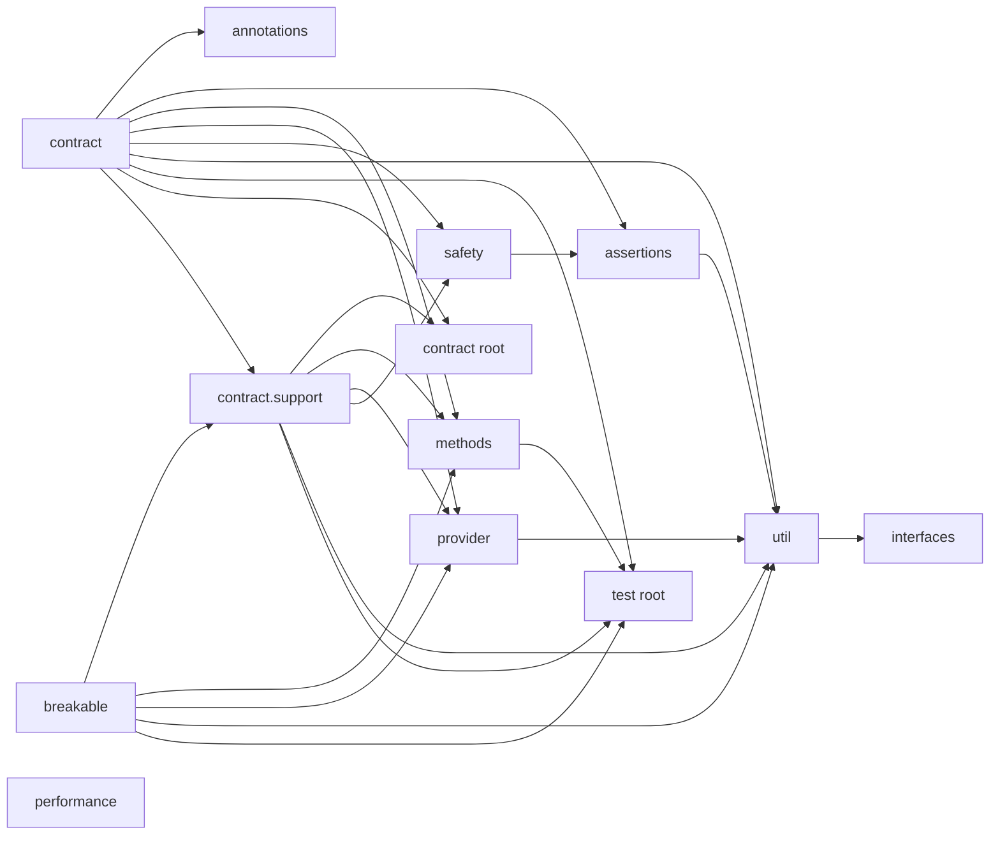

# Architecture

The packages, what each holds, what each depends on, and how the parts fit. Read [constitution.md](constitution.md) first for the goals and the rules.

## 1. Overview

Built. One Maven module, `com.soliscode:soliscode-test`, a jar, with `com.soliscode:soliscode-parent:0.1.13` as its parent (#9, #14, #57, #64, #69, #71). There is no `module-info.java`: the jar is on the class path, with every package open to its users.

Its main code is test code. A user's test class implements a contract interface, supplies a provider of the class under test, and JUnit runs the contract's `default` `@Test` methods as the test class's own. The library starts threads only in `ContentionCoordinator` and in `BlockingQueueContractSupport.bounded` (section 5).

The library holds almost no global state. The exceptions:
- `AbstractBreakable` keeps one `static final Random`, shared by every breakable, for the faults that pick a random value or index.
- `BreakableComparable` keeps one `static final AtomicLong`, which numbers its instances in the order they are made, for its `COMPARE_TO_BREAKS_TIES_BY_IDENTITY` (#40).
- `AssertNoDeadlocks.enableDeadlockDetection()` turns on the JVM's thread-contention monitoring (`ThreadMXBean`), for the whole JVM.
- Built (#69): `AllocationAssertion` turns on the JVM's thread allocation measurement (`com.sun.management.ThreadMXBean`), for the whole JVM, where it is supported but off; and `ProcessTopology` registers a JVM shutdown hook from `start` to `close`, which kills the processes it started that are still running (section 8).

## 2. Dependencies

Built (#9). The POM declares, at compile scope, and at the parent's versions:

| Library | Why |
|---------|-----|
| JUnit Jupiter (`junit-jupiter`, `-api`, `-params`) | The contracts are `@Test`, `@RepeatedTest` and `@ParameterizedTest` methods; `junit-jupiter` brings the engine |
| JUnit Platform commons | `AnnotationSupport` and the other support classes |
| OpenTest4J | `AssertionFailedError`, which the assertions throw, as JUnit's do |
| JSpecify | `@NullMarked` and `@Nullable` |

Built (#69), for the performance test library (section 8), the user's decisions on #69: HdrHistogram (`org.hdrhistogram:HdrHistogram` 2.2.2, CC0 or BSD-2-Clause, which the licence gate passes by its BSD-2-Clause), for its histograms, and `com.soliscode:soliscode-performance-api`, soliscode-parent's API jar, for the scenario results it returns, both at compile scope, the API jar with `org.openjdk.jmh:jmh-core` excluded, so that this library's users do not get JMH; a module that runs the gate gets it from the parent's `performance` profile. The API jar is part of soliscode-parent's gate, not a SolisCode library released on its own. HdrHistogram's version is the parent's, from 0.1.12 (soliscode/soliscode-parent#31, the user's decision on #69).

They are at compile scope because the library is a test library: its main code calls them, and its users' tests run on them. A user declares soliscode-test at test scope. It depends on no other SolisCode library. Versions are in [dependency-management.md](../reference/dependency-management.md).

Its users are soliscode-common and soliscode-quant (soliscode/soliscode-quant#6); each depends on a release of it at test scope, by its own task.

## 3. Packages

Built. Every package is under `com.soliscode.test`, and every main package has a `package-info.java` marked `@NullMarked`.

| Package | What |
|---------|------|
| `test` (the root) | Method support: `InterfaceMethod` (implemented by each interface's method enum), `SupportedMethods`, `MethodSupport` and `MethodStatus`, which say which optional methods a class under test (or a breakable) supports; `AbstractTest` |
| `annotations` | Test tags: `@Slow`, `@VerySlow`, `@ExtremelySlow`, `@ConcurrencyTest` (which also tags the test `@Nondeterministic`), `@Nondeterministic`, and their names in `TestTags`. The build skips `extremely-slow` by default ([build-and-test.md](../reference/build-and-test.md)) |
| `assertions` | `Assertions`, which aggregates the package's assertions: ordering (`AssertGreaterThan` and its kin), types (`AssertImplementsOnly`, `AssertNotInstanceOf`), exceptions (`AssertThrowsAnyOf`, `AssertThrowsDifferent`), arrays, and `AssertNoDeadlocks` |
| `assertions.actions` | Assertions on what an action does to the elements it is given (`AssertConsumeExactly` and its kin), aggregated by `AssertActions` |
| `assertions.collection` | Assertions on collections: contents, by equality and by identity, size and emptiness, aggregated by `CollectionAssertions` |
| `assertions.string` | `AssertStringContains`, `AssertStringContainsInOrder` |
| `breakable` | `Break`, `Breakable`, `AbstractBreakable`, the breakable classes and their builders, and `Breakables`, the factory of builders (section 4) |
| `methods` | Built (#67). The method enums, one per interface with optional methods (`CollectionMethods`, `ListMethods`, `MapMethods` and the others: `BlockingDequeMethods`, `BlockingQueueMethods`, `DequeMethods`, `IterableMethods`, `ListIteratorMethods`, `MapEntryMethods`, `NavigableMapMethods`, `ObjectMethods`, `QueueMethods`, `SequencedCollectionMethods`, `SequencedMapMethods`, `SortedMapMethods`, `TransferQueueMethods`), each implementing `InterfaceMethod`. Until #67 each lived in its interface's `contract.<interface>` package; they moved so that the breakables, which name them, need no contract package of their own interface (section 3.1) |
| `contract` | `CollectionContractConfig` (whether the class under test permits nulls, duplicates and incompatible types) and its narrowings `DoesNotPermitNulls`, `DoesNotPermitDuplicates`, `DoesNotPermitIncompatibleTypes` |
| `contract.<interface>` | One package per interface, one level under `contract`: `autocloseable`, `blockingdeque`, `blockingqueue`, `charsequence`, `closeable`, `collection`, `comparable`, `comparator`, `concurrentmap`, `concurrentnavigablemap`, `deque`, `executorservice`, `future`, `iterable`, `iterator`, `list`, `listiterator`, `map`, `mapentry`, `navigablemap`, `navigableset`, `numeric`, `object`, `queue`, `sequencedcollection`, `sequencedmap`, `sequencedset`, `set`, `sortedmap`, `sortedset`, `spliterator`, `transferqueue`. Each holds the interface's contract and its method contracts; its method enum, where its interface has optional methods, is in `methods` (#67; `ListMethods`, for example; `SortedSet` and `NavigableSet` have none, since their interfaces' own methods are not optional). `Iterator` has none either, though `Iterator.remove` is optional: `contract.iterator` uses `IterableMethods.ITERATOR_REMOVE`, which `BreakableIterator` already reads and users already set, so that a new constant would change what they configure (#37); `ListIteratorMethods` (in `methods`) names `ListIterator`'s `set` and `add`. `contract.iterator` also holds `WeaklyConsistentIteratorContract`, which extends `IteratorContract` with tests of an iterator whose source changes during a traversal (#55); the concurrent contracts run the same checks through method contracts of their own packages: `IteratorWeakConsistencyContract` (`blockingqueue`), `DescendingIteratorWeakConsistencyContract` (`blockingdeque`), `ViewIteratorsWeakConsistencyContract` (`concurrentmap`) and `KeySetViewsWeakConsistencyContract` (`concurrentnavigablemap`). `contract.spliterator` has none, since `Spliterator` has no optional methods; it holds `SpliteratorContract`, a method contract for each method, `ReportedCharacteristicsContract` (a test for each characteristic) and the primitive kinds' `SpliteratorOfIntContract`, `SpliteratorOfLongContract` and `SpliteratorOfDoubleContract` (#38). `contract.mapentry` holds `MapEntryContract`, a method contract for each method (`GetKeyContract`, `GetValueContract`, `SetValueContract`, `EqualsContract`, `HashCodeContract`); `MapEntryMethods` (`MAP_ENTRY_SET_VALUE`, in `methods`) names the optional `setValue` (#39). `contract.comparable` holds `ComparableContract` and `CompareToContract`, the contract of its one method, and its interface has no enum in `methods`, since `Comparable` has no optional methods (#40). `contract.autocloseable` holds `AutoCloseableContract` and `CloseContract`, the contract of its one method, and `contract.closeable` `CloseableContract`, which extends it, and `CloseableCloseContract`, which overrides `CloseContract`'s test of a second `close` to run whatever `closeIsIdempotent()` says, as `Closeable` requires; neither interface has an enum in `methods`, since `close` is not optional (#41). `contract.comparator` holds `ComparatorContract` and its method contracts, `CompareContract`, `ReversedContract`, `ThenComparingContract` (every `thenComparing` form) and `NullsFirstAndNullsLastContract` (the JDK's wrappers made from the comparator, whose `reversed()` and `thenComparing` call the comparator's own), with a package-private `ComparatorChecks` of the assertions they share, and its interface has no enum in `methods`, since `Comparator` has no optional methods (#42); it is not `contract.sortedmap`'s or `contract.sortedset`'s `ComparatorContract`, which test a sorted collection's `comparator()`. `contract.charsequence` holds `CharSequenceContract` and a method contract for each of `CharSequence`'s nine methods as of Java 25 (`LengthContract`, `CharAtContract`, `IsEmptyContract`, `SubSequenceContract`, `ToStringContract`, `CharsContract`, `CodePointsContract`, `CompareContract`, of the static `compare`, and `GetCharsContract`), with a package-private `CharSequenceChecks` of the contract's own oracles (the code points and the lexicographic order of a content, computed with `length` and `charAt` alone), and its interface has no enum in `methods`, since `CharSequence` has no optional methods (#43). `contract.future` holds `FutureContract` and a method contract for each of `Future`'s eight methods as of Java 25 (`CancelContract`, `IsCancelledContract`, `IsDoneContract`, `GetContract`, which also tests a `null` result, `TimedGetContract`, `ResultNowContract`, `ExceptionNowContract`, `StateContract`), and `ThreadSafeFutureContract` with its `ThreadSafeGetContract` (a `get`, timed or not, sees a completion another thread makes while it waits) and `ThreadSafeCancelContract` (of cancels made at once, at least one returns `true`), bounded by a deadline of their own; its interface has no enum in `methods`, since `Future` has no optional methods (#44). `contract.executorservice` holds `ExecutorServiceContract` and a method contract for each of `ExecutorService`'s methods as of Java 25 and `Executor`'s `execute` (`ExecuteContract`, `SubmitCallableContract`, `SubmitRunnableContract`, `SubmitRunnableWithResultContract`, `ShutdownContract`, `ShutdownNowContract`, `IsShutdownContract`, `IsTerminatedContract`, `AwaitTerminationContract`, `CloseContract`, which is not `contract.autocloseable`'s, `InvokeAllContract`, `TimedInvokeAllContract`, `InvokeAnyContract`, `TimedInvokeAnyContract`), and `ThreadSafeExecutorServiceContract` with its `ThreadSafeSubmitContract` (tasks submitted from several threads at once each run once, with the happens-before edges the Javadoc states) and `ThreadSafeShutdownContract` (of tasks submitted while another thread shuts the executor down, each accepted one runs once), bounded by a deadline of their own; its interface has no enum in `methods`, since `ExecutorService` has no optional methods (#45). `contract.blockingqueue` also holds `ThreadSafeBlockingQueueContract` and its method contracts, `contract.blockingdeque` `ThreadSafeBlockingDequeContract` and its, with `FullDequeContract` for the non-blocking inserts on a full deque, `contract.transferqueue` `ThreadSafeTransferQueueContract` and its, and `contract.concurrentmap` `ThreadSafeConcurrentMapContract`, its method contracts and their `ThreadSafeConcurrentMapContractSupport` (#35). `contract.sequencedcollection` holds `ThreadSafeSequencedCollectionContract`, its method contracts (`ThreadSafeAddRemoveFirstLastContract`, `ThreadSafeGetFirstLastContract`, `ThreadSafeReversedContract`) and their `ThreadSafeSequencedCollectionContractSupport` (#22). `contract.concurrentnavigablemap` has no thread-safety contract of its own: `ThreadSafeConcurrentMapContract` covers it (#36). `contract.object` also holds `WithString`, the mix-in that gives `ObjectContract` a `String` provider, which was in `contract.support` until #67 |
| `contract.support` | The interfaces a contract extends: `ContractSupport` (with `PHASE_INTERVAL` and `contentionCoordinator()`, a `ContentionCoordinator` in phases, for the thread-safety tests, #54), `ProviderSupport`, `CollectionContractSupport`, `MapContractSupport`, `OrderedMapContractSupport`, `SortedSetContractSupport`, `BlockingQueueContractSupport` (a full queue, calls that may block run with a time limit, a test that one thread's call waits for another's), `TransferQueueContractSupport` (consumers known to be waiting, #34), `ConcurrentMapContractSupport` (null refusal expected, and the shared assertions, #35), `ConcurrentNavigableMapContractSupport` (that a view is backed by the map, both ways, #36), `IteratorProviderSupport` and `IteratorContractSupport` (the iterator under test's sources, its elements, and comparison in order or as a multiset, #37), `SpliteratorProviderSupport` and `SpliteratorContractSupport` (the spliterator under test's sources, traversals and recursive splits bounded by calls, #38), `MapEntryProviderSupport` and `MapEntryContractSupport` (the entry under test's sources, its keys and values, and a reference entry to compare with, #39), `ComparableProviderSupport` and `ComparableContractSupport` (the ordered samples, checked, with their tiers and indexes, and `naturalOrderingIsConsistentWithEquals()`, `true` unless a class opts out, #40), `AutoCloseableProviderSupport` and `AutoCloseableContractSupport` (the provider's resources and uses, checked, the steps that open, use and close a resource exactly once, and `closeIsIdempotent()`, `true` unless a class opts out, #41), `ComparatorProviderSupport` and `ComparatorContractSupport` (the comparator and its ordered samples, checked, the law samples, with `null` where the comparator permits it, the samples' positions by identity that give the `thenComparing` tests their tie-breaker and keys, and `comparatorIsConsistentWithEquals()`, `true`, and `comparatorPermitsNulls()`, `false`, unless a class says otherwise, #42; it and `ComparableContractSupport` check their tiers with the package-private `SampleTiers`), `CharSequenceProviderSupport` and `CharSequenceContractSupport` (the contents, checked, the sequences under test made of them, and `naturalOrderIsByChar()`, `true` unless a `Comparable` class with another natural order opts out, #43), `FutureProviderSupport` and `FutureContractSupport` (pending futures, checked, and finished each way, every call that may block run with a time limit, a test that one thread's `get` waits for another thread, and `permitsNullResult()`, `true` unless a class opts out; its bounded calls are copies of `BlockingQueueContractSupport`'s, since moving them would rename its `BlockingAction`, #44), `ExecutorServiceProviderSupport` and `ExecutorServiceContractSupport` (new executors, checked, each test run on its own and shut down afterwards, bounded, gates that hold tasks running or queued, calls that may block run with a time limit, a test that one thread's call waits for another thread, the cause of a task's exception, itself or `ForkJoinTask`'s copy, and `rejectsTasksAfterShutdown()`, `true` unless a class that discards such tasks opts out; its bounded calls are copies of `FutureContractSupport`'s, for the same reason, #45), `WeakConsistencyChecks` (the changes during a traversal and the checks of a weakly consistent iterator) and `WeaklyConsistentIteratorsSupport` (the opt-out, `iteratorsAreWeaklyConsistent()`, #55) and `UpdateLog` (checks that no update to a key was lost, without counting, #35), the provider supports, and the mix-ins that fix a type (`WithInteger`, `WithArrayList`, `WithLinkedList`, `WithSynchronizedCollection`, and others) |
| `interfaces` | `IterableOnly`, `CollectionOnly`, `NumberOnly` and `ObjectOnly`, which hide every method but their interface's, so that code which takes a faster path for a richer interface takes the plain one; `Interfaces` makes them |
| `provider` | `ObjectProvider` and its kinds (`NumberProvider`, `CollectionProvider`, `MapProvider`, `FunctionalProvider`), `IteratorProvider` and the `IteratorSource` it makes, a source of given elements with the iterators under test over it (#37), which can also be changed other than through them (`removeFromSource`, `addToSource`, #55), `SpliteratorProvider` and its `SpliteratorSource`, which also says what the source's class documents (its characteristics and comparator) and can remove an element during a traversal (#38), `MapEntryProvider` and its `MapEntrySource`, an entry under test of a given mapping, which reads the map behind it, if there is one, other than through it (#39), `ComparableProvider`, which gives the ordered samples of a `Comparable` in tiers that compare as equal (#40), `AutoCloseableProvider`, which opens new resources and gives the `ResourceUse`s their class documents, each with what it does once closed (#41), `ComparatorProvider`, which gives the comparator under test and samples in tiers in its order (#42), `CharSequenceProvider`, which makes sequences of the class under test of given contents (#43), `FutureProvider` and the `FutureSource` it makes, a pending future with the way to finish it (#44), `ExecutorServiceProvider`, which makes new executors of the class under test (#45), providers for `Integer`, `Long`, `Short`, `Double`, `Float` and `String`, and the factories `Providers`, `CollectionProviders`, `MapProviders`, `IteratorProviders`, `SpliteratorProviders`, `MapEntryProviders` and `ComparableProviders` (`of`, `ascending`, `integers`, `strings`, `bigDecimals`) and `AutoCloseableProviders` (`of`, `withoutUses`, `bufferedReader`, `byteArrayOutputStream`) and `ComparatorProviders` (`of`, `ascending`, `naturalOrder`, `reverseOrder`, `caseInsensitiveOrder`) and `CharSequenceProviders` (`of`, `standardContents`, `strings`, `stringBuilders`, `charBuffers`) and `FutureProviders` (`completedBy`, `ofTask`, `completableFutures`, `futureTasks`) and `ExecutorServiceProviders` (`of`, `fixedThreadPools`, `virtualThreadPerTaskExecutors`, `forkJoinPools`) |
| `safety` | `ContentionCoordinator` (section 5) |
| `performance` | Built (#69). The performance test library: `LatencyRecorder`, `OpenLoopPacer` and its `PacedOperation` and `PacedRun`, `Sweep`, `AllocationAssertion`, `ProcessTopology` with `ProcessSpec`, `ReadinessCheck` and `TopologyProcess`, `StageTaps`, `HeapSoak` (section 8). It depends on no other package of this project |
| `util` | Helpers for tests: collection, iterable, reflection and runtime utilities; `UnbrokenView`, the view of a breakable without its breaks, which `BreakableIterable` implements and `IterableTestUtils` reads (Built, #67); consumers and suppliers that count or record; `UncachedInteger` and `UncachedString`, values that are equal but not identical; `IdentitySet`; `AlwaysThrows`, `MatchEverything`, `MatchNothing` |

The test sources mirror the main packages, and add `contract.coverage`, which holds `ContractCoverageTest` and `ContractRuns` (section 4).

### 3.1 What depends on what

Built (#67): the graph below has no cycle, which the architecture gate (soliscode-parent 0.1.9, `noPackageCycles`) checks between every two packages, each `contract.<interface>` package a node of its own. Before #67 it had one tangle of 25 packages; the moves that break it are listed after the graph.

- The contracts do not depend on the breakables: a contract tests any implementation of its interface.
- The breakables depend on `methods`, for the enums that name the optional methods a breakable may refuse, and on `contract.support` alone of the contract packages, for the provider supports (`CollectionProviderSupport`, `MapProviderSupport`) behind each breakable's nested `WithProvider` interface. Nothing in `contract.support` depends on `breakable`, directly or through others.
- `annotations`, `interfaces` and `performance` (Built, #69) depend on no other package of this project; `provider` only on `util`, and `util` only on `interfaces`.
- In the graph, `contract` is every `contract.<interface>` package, and `contract root` the package `contract` itself, which holds `CollectionContractConfig` and depends on no package of this project. Within `contract`, an interface's package depends on those of the interfaces it extends, on `contract.support`, on the root `contract` package, and, for `contract.iterable` and `contract.map`, on `contract.object`; `contract.support` depends on no `contract.<interface>` package.

The moves of #67 (Built), each recorded in `RELEASES.md`: the two moves as breaks of the public API, the addition as an addition:
- The 16 method enums move from their `contract.<interface>` packages to `methods`, so that `breakable` no longer depends on 15 contract packages, which depend, through `contract.support`, `provider` and `util`, on `breakable` (the user's decision on #64).
- `WithString` moves from `contract.support` to `contract.object`: it extends `ObjectContract`, whose package depends on `contract.support` (the user's decision on #67).
- `util` gains `UnbrokenView<E>`, an `Iterable<E>` with `unbroken()`, which `BreakableIterable` implements (and `BreakableCollection`, whose `unbroken()` returns a `Collection<E>`, through it). `IterableTestUtils` unwraps a breakable through it rather than through `Breakables.ensureUnbroken`, so `util` no longer depends on `breakable` (the user's decision on #67). `Breakables.ensureUnbroken` stays, unchanged. `BreakableIterable` declares no `serialVersionUID`, and a new interface changes the one Java computes, so it gains `serialVersionUID = 1825535398663778434L`, the value computed before the change (`serialver`), and the 0.1.4 serialization fixture (`BreakableSerializationTest`) is the check that its 0.1.4 streams still read.
- `methods` has a `package-info.java` marked `@NullMarked`, as every main package does.

What the moves change in the serialized form: an enum constant is written with its class's name, so a method status written after #67 names a `com.soliscode.test.methods` class. 0.1.4, which lacks those classes, fails to read a breakable written with any method status set (`ClassNotFoundException`), where before #67 it read one and dropped the statuses (RELEASES.md, T-0059). A breakable with no status set, and every stream 0.1.4 wrote, which holds none, still read both ways.

## 4. Contracts, breakables and providers

Built (#1, #4, #6).

**A contract** is an interface. An interface contract (`ListContract`) extends the contract of each method of its interface (`GetContract`, `SubListContract`, ...) and the interface contracts it inherits from (`SequencedCollectionContract`, and through it `CollectionContract` and `IterableContract`). A method contract extends a support interface (`CollectionContractSupport`, `MapContractSupport`), which gives it the provider of the class under test, the element provider, `supportsMethod(...)` and the configuration in `CollectionContractConfig`. Its test methods are `default` methods annotated `@Test` (or `@RepeatedTest`, or a concurrency test tagged `@ConcurrencyTest`), each with a `@DisplayName`. A test class picks the type under test by implementing a `With...` mix-in or by supplying its own provider.

**A breakable** wraps a JDK implementation and delegates to it, except where a break is set; `BreakableCloseable` (#41), `BreakableFuture` (#44) and `BreakableExecutorService` (#45) are the ones that do not delegate: the first is a resource of its own, a closed flag and a count of reads, the second a future of its own, a state and an outcome under a lock, and the third an executor of its own, a fixed number of worker threads over a queue, with a run state, under a lock, so that each break acts on that state and nothing else, and the thread-unsafe ones can step outside the lock. `AbstractBreakable` holds the breaks (a `Set<Break>`) and the method support it inherits from `MethodSupport`; a breakable checks `hasBreak(...)` in each method a break affects, and `checkMethodSupport(...)` in each optional method. The classes form a hierarchy that follows the interfaces': `BreakableObject` → `BreakableIterable` → `BreakableCollection` → `BreakableSequencedCollection` → `BreakableList`, with the `BreakableSet` and `BreakableQueue` branches below `BreakableCollection`. `BreakableMap` (with `BreakableSortedMap`, `BreakableNavigableMap` and the concurrent maps below it), `BreakableIterator`, `BreakableSpliterator`, `BreakableMapEntry` (#39), `BreakableComparable` (#40), `BreakableCloseable` (#41), `BreakableComparator` (#42), `BreakableCharSequence` (#43), `BreakableFuture` (#44) and `BreakableExecutorService` (#45) extend `AbstractBreakable` directly, and `BreakableListIterator` extends `BreakableIterator` (#37); `BreakableSpliteratorOfInt`, `BreakableSpliteratorOfLong` and `BreakableSpliteratorOfDouble` extend `BreakableSpliterator`, with no breaks of their own (#38). A `BreakableSpliterator`'s characteristics follow its delegate's, with those it was made to add or take away (#38). A break is a `Break` record, a `public static final` constant in the first class that supports it; a subclass inherits its superclasses' breaks. Each breakable but `BreakableIterator`, `BreakableListIterator`, the spliterators, `BreakableMapEntry`, `BreakableComparable`, `BreakableCloseable`, `BreakableComparator`, `BreakableCharSequence`, `BreakableFuture`, `BreakableExecutorService` and `BreakableObject` has a nested `Builder`, on `AbstractBreakableBuilder`, which sets its elements, its breaks, the methods it does not support, and whether it is thread safe; `Breakables` makes the builders.

**A provider** makes instances. `ObjectProvider<T>` makes values (a default one, one from an integer seed, unique ones, a copy that is equal but not identical); `CollectionProvider` and `MapProvider` make the class under test, empty or filled from elements.

**`ContractCoverageTest`** shows that each contract can pass and fail (constitution, goal 4). For each covered contract, `ContractRuns` runs every test method, outside JUnit, against a contract instance on a JDK class, then on the unbroken breakable, then on the breakable with each of its breaks in turn, each applied alone through the builder (or, for a breakable with none, its constructor, in the coverage test's subjects), with the configuration a break needs to show (a method not supported, incompatible types refused). A test method that hangs is stopped after 10 seconds (60 for a concurrency test), and a concurrency test is tried up to 5 times before a break is taken to be missed. Thread-safety breaks are checked by the thread-safety contracts only: `BreakableBlockingQueue`'s own by `ThreadSafeBlockingQueueContract`, `BreakableBlockingDeque`'s own by `ThreadSafeBlockingDequeContract`, `BreakableTransferQueue`'s own and `BreakableBlockingQueue`'s (its `take`, `poll` and `drainTo` run on the transfer queue's store) by `ThreadSafeTransferQueueContract`, `BreakableConcurrentMap`'s by `ThreadSafeConcurrentMapContract` (#35), on `BreakableConcurrentMap` and on `BreakableConcurrentNavigableMap`, which inherits them (#36), `BreakableSequencedCollection`'s by `ThreadSafeSequencedCollectionContract` (#22), the others by `ThreadSafeCollectionContract`. `ConcurrentMapContract` and `ConcurrentNavigableMapContract` are also run against their breakable with each of `BreakableConcurrentMap`'s thread-safety breaks, and must pass: each is correct on one thread, so that only contention shows it. `ConcurrentNavigableMapContract` also passes against four views of a `ConcurrentSkipListMap`, and `ThreadSafeConcurrentMapContract` against four more (#36): that is how the contracts test "recursively so for its navigable sub-maps". `WeaklyConsistentIteratorContract` (#55) runs on `IteratorSubjects` too: it passes against the iterators of `ConcurrentLinkedQueue`, `ConcurrentHashMap.newKeySet()`, `ConcurrentSkipListSet`, `CopyOnWriteArrayList`, `LinkedBlockingQueue` and a full `ArrayBlockingQueue`, fails against `ArrayList`'s, and fails for each break of `BreakableIterator` on a breakable over a `ConcurrentLinkedQueue`'s iterator. The three weak-consistency breaks of `BreakableIterator` act only on a change to the source, seen through a probe of its size that a breakable passes only where one of them is set (`BreakableIterable.iterator()`, and, for the iterators that do not come from there, `BreakableDeque.descendingIterator()` and `BreakableConcurrentNavigableMap`'s key sets, through `WeakConsistencyViews`; `BreakableConcurrentMap`'s key, value and entry views carry them, and only them, as the breaks that name them, #52); they are checked by the contracts that make such a change, and the map runs take them alone of `BreakableIterator`'s breaks. `IteratorContract` and `ListIteratorContract` (#37) run on test subjects of their own (`IteratorSubjects`): each passes against `ArrayList`'s and `LinkedList`'s iterators, `List.of`'s and `Arrays.asList`'s (their unsupported methods), and, for `IteratorContract`, a `PriorityQueue`'s (unordered), and fails for each break of `BreakableIterator`, and of `BreakableListIterator` for the second. Their `forEachRemaining`-unsupported break is left out: `forEachRemaining` is not optional in `Iterator`. `SpliteratorContract` (#38) runs on subjects of its own (`SpliteratorSubjects`): it passes against the spliterators of `ArrayList`, `TreeSet` (natural and reversed), `IntStream.range`, `LinkedList`, `HashSet`, `List.of`, `CopyOnWriteArrayList`, `ConcurrentLinkedQueue` and `ConcurrentSkipListSet`, and fails for each break of `BreakableSpliterator` over an `ArrayList`'s; the characteristic tests that subject cannot fail are shown to fail by name on breakables over a `TreeSet`, an `IntStream.range` and an unknown-size spliterator. The primitive contracts pass against ranges and arrays, fail for each break on a breakable over an array, and their own tests are shown to fail apart from the inherited ones. The spliterator breaks #38 added are checked only by the spliterator contracts. `MapEntryContract` (#39) runs on subjects of its own (`MapEntrySubjects`): it passes against `AbstractMap.SimpleEntry`, `AbstractMap.SimpleImmutableEntry` and `Map.entry` (the last two with `setValue` unsupported) and the entries of a `HashMap` and a `TreeMap`, and fails for each break of `BreakableMapEntry` over a `HashMap`'s entry, whose map the write-through check reads. `ComparableContract` (#40) runs on subjects of its own (`ComparableSubjects`): it passes against `Integer`, `String`, `BigDecimal` (which opts out of consistency with `equals`) and `Boolean` (two tiers), fails against `BigDecimal` claimed consistent, and fails for each break of `BreakableComparable` over the `Integer` samples, each value wrapped twice so that the consistency test has equal pairs that are not identical. It also shows, by name, that the test each break targets fails for it, that every test method is one of them, and that the tests of the laws each break claims to keep pass with it. `AutoCloseableContract` and `CloseableContract` (#41) run on subjects of their own (`CloseableSubjects`): each passes against a `BufferedReader` over a `StringReader` and a `ByteArrayOutputStream`, and `AutoCloseableContract` against an `ExecutorService` too (in test code: the library starts threads only in `ContentionCoordinator` and `BlockingQueueContractSupport.bounded`, section 1), and each fails for each break of `BreakableCloseable`. `AutoCloseableContract` passes on a breakable that opts out of idempotence with each of the two second-close breaks, and `CloseableContract` fails there, since it ignores the opt-out. For both it also shows, by name, that the test each break targets fails for it, that every test method is one of them, and that the tests each break should leave alone pass with it. `ComparatorContract` (#42) runs on subjects of its own (`ComparatorSubjects`): it passes against `Comparator.naturalOrder()` and `reverseOrder()` over the `Integer` samples, `String.CASE_INSENSITIVE_ORDER` (which opts out of consistency with `equals`), `Comparator.nullsFirst(naturalOrder())` (which permits nulls) and the breakable with `COMPARE_NULL_DOES_NOT_THROW`, permitting nulls; it fails against `CASE_INSENSITIVE_ORDER` claimed consistent, `naturalOrder()` claimed to permit nulls and `nullsFirst(naturalOrder())` claimed to refuse them, and for each break of `BreakableComparator` over `naturalOrder()`. By name, it shows that each test a break targets fails for it, that the targets cover every test method, and that every test a break neither targets nor is listed as also failing passes with it. `CharSequenceContract` (#43) runs on subjects of its own (`CharSequenceSubjects`): it passes against `String`, `StringBuilder`, `StringBuffer`, a `CharBuffer` on a new array, one at a nonzero position and a read-only `CharBuffer.wrap(CharSequence)`, a test-local sequence that implements only the four abstract methods, so that `isEmpty`, `chars`, `codePoints` and `getChars` run the interface's defaults, and the breakable with `COMPARE_TO_COMPARES_LENGTHS_FIRST`, which opts out of a natural order by `char`; and it fails for each break of `BreakableCharSequence` over a `String`. By name, it shows that each test a break targets fails for it, that the targets cover every test method, and that every test a break neither targets nor is listed as also failing passes with it. The JDK sorted- and navigable-set subjects are in `SortedSetSubjects`.

## 5. Threading

Built. The library starts threads only in `ContentionCoordinator` and in `BlockingQueueContractSupport.bounded` (#32), which makes a call that may block on a daemon thread of its own, one per call (`blocking-queue-contract`), and interrupts it if it has not returned within 5 seconds. `ContentionCoordinator` runs each configured operation on one subject from a fixed pool of threads of its own (`ContentionCoordinator-N`), holds them at a latch until all are ready, releases them together, calls `Thread.yield()` in the workers' loops, before the first iteration and then once every `yieldInterval` iterations (64 by default; #12), to make contention likelier, can hold them together in phases (a phase interval; after each interval of its calls a worker waits, spinning while there are more cores than workers and yielding otherwise, until the others still running have made as many, and leaves the phases once it has no arrival left; #54), collects every exception the workers throw, and shuts the pool down with a timeout (5 seconds by default, to start and to finish), so that a deadlocked worker fails the test rather than hanging it. Its configuration is thread safe. The thread-safety contracts (`ThreadSafeAddContract`, `ThreadSafeReadContract` and the others in `contract.collection`, `ThreadSafePutTakeContract`, `ThreadSafeOfferPollContract` and `ThreadSafeDrainToContract` in `contract.blockingqueue`, `ThreadSafePutTakeFirstLastContract` and `ThreadSafeOfferPollFirstLastContract` in `contract.blockingdeque`, `ThreadSafeTransferContract` and `ThreadSafeTryTransferContract` in `contract.transferqueue`, and the twelve `ThreadSafe*Contract`s in `contract.concurrentmap`, #35), the blocking queue's wake-up tests and the transfer queue's waiting consumers (`TransferQueueContractSupport.withWaitingConsumers`, #34) use it, with `AssertNoDeadlocks`, which finds deadlocked threads through `ThreadMXBean`.

Built (#69): the performance library starts no thread (section 8). `ProcessTopology` registers a JVM shutdown hook, a thread the JVM starts only at its shutdown, from `start` to `close`, and starts processes, whose output goes to files.

A breakable is thread safe only when built so (`setSafe(true)` on its builder). Then `AbstractBreakable` holds a `ReentrantLock`, and `BreakableCollection` and `BreakableSequencedCollection` (and the classes below them) run each operation under it, through `runWithBreakableSafety` and `getWithBreakableSafety`, unless the operation's `..._IS_NOT_THREAD_SAFE` break is set, which runs it without the lock. That is how `ThreadSafeCollectionContract`, and for the sequenced methods `ThreadSafeSequencedCollectionContract` (#22), are shown to fail. The lock is `transient`, and restored on deserialization if the object had one. The breaks and the method statuses survive serialization (#59): `MethodSupport` is not `Serializable`, so `AbstractBreakable` writes the statuses itself, as two arrays of methods in `serialPersistentFields` beside the breaks, a form that 0.1.4 reads, dropping the statuses, when no status is set (since #67 a status names a `com.soliscode.test.methods` class, which 0.1.4 lacks, section 3.1), and whose 0.1.4 streams read with none. The rest of a breakable's state (its breaks, its method support, a `HashSet` and a `HashMap`) is not synchronized: it is set before the breakable is shared, and the breakable is safely published (its fields are not final, so that `clone()` can copy them, #58). A builder is not thread safe. The lock guards the methods `BreakableCollection` and `BreakableSequencedCollection` define, and (#52) the methods of every breakable that has views, so that a view of a safe breakable runs under it: `BreakableIterable.forEach`, the collections' `equals`, `hashCode` and `toString`, `BreakableSequencedSet`'s own, `BreakableSortedSet`'s and `BreakableNavigableSet`'s own, `BreakableList`'s index methods and `replaceAll`, `BreakableQueue`'s and `BreakableDeque`'s own (a deque's `reversed()` is the JDK's view over them), and every method of `BreakableMap`, `BreakableSortedMap` and `BreakableNavigableMap`, through `runWithSafety` and `getWithSafety`, which have no break to turn them off. **A view** (#52) is a breakable of the view's type over the store's view, made by the parent's view method (`subSet`, `headSet`, `tailSet`, `descendingSet`, `reversed`, `subList`, `keySet`, `values`, `entrySet`, `subMap`, `headMap`, `tailMap`, `descendingMap`, `navigableKeySet`, `descendingKeySet`): it shares the parent's lock, the same `ReentrantLock` or none, as `Collections.synchronizedSortedSet` and the other synchronized wrappers synchronize a view on the parent's lock; it carries the parent's method statuses, as the JDK's unmodifiable wrappers make a view of an unmodifiable collection unmodifiable; and it carries none of the parent's breaks, since a break describes a method of the parent (the user's decisions on #52). A map's collection views take the map's statuses mapped to their own methods: `MapMethods.REMOVE`'s for `remove`, `removeAll`, `retainAll`, `removeIf`, the iterator's `remove`, and a key set's `pollFirst`, `pollLast`, `removeFirst` and `removeLast`, `MapMethods.CLEAR`'s for `clear`, and, where `MapMethods.PUT` is unsupported, entries whose `setValue` is unsupported, on every path that hands one out (the iterator, `forEach`, the spliterator and so `stream`, and `toArray`); a view of such a view carries the mapped statuses; `add` and `addAll` are unsupported on them, as `Map`'s Javadoc says. A break that names the view acts in the parent's view method, which picks the store the view wraps (a range with a bound moved, a `RangeIgnoringView`, a weakly consistent view) or returns something that is not a view (a copy, an empty set, `null`, the parent itself), which is returned as it is; `REVERSED_IS_NOT_THREAD_SAFE` turns the lock off for the `reversed()` call and gives its view no lock, the one view of a safe breakable that holds none (#22). A copy of a view, made by `clone()`, a copy constructor or deserialization, gets a lock of its own if the view had one. As in the synchronized wrappers, a traversal of an iterator or spliterator is not made under the lock. A `BreakableConcurrentMap` and a `BreakableConcurrentNavigableMap`, and a `BreakableBlockingQueue`, `BreakableBlockingDeque` and `BreakableTransferQueue`, take no lock (#52; until then the concurrent maps held one that nothing took): their protected constructors give `AbstractBreakable` no lock whatever they are given, so that `setSafe` is ignored and a copy holds none, and they report `isSafe()` `true`: their stores are thread safe, and a blocking call made under the lock would hold out every other thread. Their views are made as above, with no lock; the concurrent maps' key, value and entry views are then wrapped in `WeakConsistencyViews` with the parent's breaks, since the weak-consistency iterator breaks name them. A `BreakableBlockingQueue`'s store is a thread-safe JDK `BlockingQueue`, so the lock adds nothing there: its thread-safety breaks (`TAKE_IS_NOT_THREAD_SAFE`, `POLL_IS_NOT_THREAD_SAFE`, `DRAIN_TO_IS_NOT_THREAD_SAFE`, #32) instead read the store and then remove from it in two steps, which `ThreadSafeBlockingQueueContract` is shown to catch. A `BreakableBlockingDeque`'s are the same kind, on a JDK `BlockingDeque` (`TAKE_FIRST_IS_NOT_THREAD_SAFE`, `TAKE_LAST_IS_NOT_THREAD_SAFE`, `POLL_FIRST_WITH_TIMEOUT_IS_NOT_THREAD_SAFE`, `POLL_LAST_WITH_TIMEOUT_IS_NOT_THREAD_SAFE`, `DRAIN_TO_IS_NOT_THREAD_SAFE`, #33), caught by `ThreadSafeBlockingDequeContract`. A `BreakableTransferQueue`'s store is a `LinkedTransferQueue`, or, built with a capacity or fairness, its own `BoundedTransferQueue` on one `ReentrantLock` (#34); its thread-safety breaks (`TRANSFER_IS_NOT_THREAD_SAFE`, `TRY_TRANSFER_IS_NOT_THREAD_SAFE`) check the store for a waiting consumer and then offer to it, in two steps, and `ThreadSafeTransferQueueContract` is shown to catch them and `BreakableBlockingQueue`'s. A `BreakableConcurrentMap`'s store is a concurrent map, a `ConcurrentHashMap` unless another is given, and the breakable takes no lock of its own; its thread-safety breaks (`PUT_IF_ABSENT_IS_NOT_THREAD_SAFE`, `COMPUTE_IS_NOT_THREAD_SAFE` and eleven others, #35) run the method as the check-then-act `ConcurrentMap`'s Javadoc calls it "equivalent to", in separate steps on the store, which `ThreadSafeConcurrentMapContract` is shown to catch. It refuses null keys and values, as its store does.

## 6. Nullness

Built (#9). Every main package is `@NullMarked` (JSpecify), and `@Nullable`, as a type annotation, marks what may be null (`CollectionTestUtils.listOf(@Nullable E ...)`, for example). Of the test packages, only `contract.coverage` has a `package-info.java`, and only it is `@NullMarked`; NullAway does not check test code. NullAway checks the main code at ERROR. The eight places where a contract passes `null` to a JDK method on purpose (four added by #32), to test that it is refused, carry a suppression with its reason (constitution, section 6). Contracts and breakables typed with nullable element types are #13.

## 7. Build

Built (#9, #10, #14). The parent holds the build: every version, Java 25, the enforcer, the licence gate, Checkstyle, Javadoc, ErrorProne and NullAway, the coverage check, and the `${revision}` version. This project adds `.mvn/jvm.config`, the `.errorprone` file that switches ErrorProne on, `jacoco.minimum.coverage` at 0.70, and the test-tag selection (`excludedGroups`, the `all-tests` profile). Every gate passes (#10). [build-and-test.md](../reference/build-and-test.md) says what runs and how; releases are local to `~/.m2` ([RELEASES.md](../../../RELEASES.md)).

## 8. Performance testing

Built (#69). The package `com.soliscode.test.performance` is the test-side library of the SolisCode performance framework, as soliscode-parent's `docs/design/performance/design.md`, section 12.1, sets out (its requirements R-08 to R-14, R-65, and decision D-16, which put it here). It gives a scenario (`com.soliscode.performance.PerformanceScenario`, from `soliscode-performance-api`) the parts it is measured with: histograms, a paced load, sweeps, multi-process topologies, stage taps and a heap soak; and a test an allocation assertion. It depends on `soliscode-performance-api` for `ScenarioResult`, `ScenarioMetric`, `ScenarioBound` and `MetricKind`, on HdrHistogram, and on JUnit and OpenTest4J for its assumption and its failure; on no other package of this project, and on nothing of the gate (the plugin), so that a project not on the parent (soliscode-simulator) can use it, naming the API's version itself (R-65).

What it returns is what a scenario returns: each class gives its measurements as `ScenarioMetric`s, a `time` metric in `ns`, a `rate` in `ops/s`, a `count` in a unit of its own (a `count` keeps its unit, and is never compared with a baseline), and the scenario puts them in its `ScenarioResult`. Metric names are the design's and the plugin's (`p50`, `p99.9`, `rate`), so that a module's thresholds and baselines read the same in every module.

A failure inside a scenario is an exception, not an `AssertionFailedError`: the gate's scenario JVM catches `Exception` and writes it to the run's error file, where an `Error` would reach only the scenario's log (soliscode-parent `ScenarioMain`). So every class but `AllocationAssertion`, which is for tests, fails with `IllegalArgumentException` (a refused argument, at once), `IllegalStateException` (what was measured cannot be reported) or `UnsupportedOperationException` (not on this platform).

| Class | What | Requirement |
|-------|------|-------------|
| `LatencyRecorder` | Records latencies in nanoseconds into an HdrHistogram `Histogram` sized when it is made (lowest 1 ns, the highest trackable value it is given, at least 2 ns, and 3 significant digits by default, 1 to 5), so that `record(long)` allocates nothing; a value below 0 or above the highest is refused (`IllegalArgumentException`). `metrics()` reports `p50`, `p90`, `p95`, `p99`, `p99.9` and `max` as `time` metrics in `ns`, each the histogram's value at that percentile (its highest equivalent value, so within the significant digits), and `metrics(prefix)` the same names after `<prefix>.`; an empty recorder has none to report (`IllegalStateException`). `count()`, `valueAtPercentile(double)`, `reset()`. Not thread safe: one thread records, or the caller orders the threads | R-08 |
| `OpenLoopPacer` | Calls a `PacedOperation` (`void run(long sequence) throws Exception`) at a fixed rate on the caller's thread. Operation *i*, counted from 0 with the warmup's, is scheduled at `start + i × (1 s / rate)` (the time rounded to the nanosecond, from `i`, so that it does not drift), waited for (parking until 50 µs before, then spinning), and timed from that scheduled send to its return, so that an operation late because the one before was slow counts the wait (coordinated omission). The operations scheduled in the first `warmup` are run and discarded; those scheduled in the `duration` after it are measured, each judged by the rounded time it is sent at. Every scheduled operation is run, so a slow operation makes the run longer rather than dropping sends. An exception from the operation ends the run and propagates; a latency above the highest ends it with an `IllegalStateException` naming the latency, the highest and the operation's sequence. `run` returns a `PacedRun`: its `LatencyRecorder`, the operations measured, and the achieved rate, the measured operations over the time from the measured window's scheduled start (`start + warmup`) to its scheduled end or the last measured return, whichever is later (so that operations that take no time give the rate itself); `metrics()` is the latencies and `rate` (`rate`, `ops/s`). Immutable: `OpenLoopPacer.at(rate).warmup(d).duration(d).highestLatency(d)`. A rate of 0 or less or above 10⁹ (one send a nanosecond), a negative warmup, a duration of 0 or less, a duration with fewer than 2 operations in it, and a highest latency below 2 ns are refused; the highest latency defaults to the warmup and duration together plus a minute | R-09, M4 |
| `Sweep` | The points of a parameter matrix: `Sweep.of("threads", "1", "4", "8").and("rate", "1000", "10000")` is their cross product, in declaration order (the first parameter slowest), each point an unmodifiable map in parameter order (the runner keeps its own order), which a scenario's `points()` returns, one case each. `of(String, String, String...)` and `of(String, int, int...)` take at least one value, so a parameter with none does not compile; `where(Predicate)` drops points; `Sweep.intParameter(point, name)` reads one back. A parameter named twice, a blank name, or a value given twice for one parameter is refused (`IllegalArgumentException`), and `points()` refuses (`IllegalStateException`) a sweep whose `where` drops every point, which the runner would refuse | R-10, M6 |
| `AllocationAssertion` | `bytesPerOperation(n, operation)` runs the operation `n` times to warm it, then `n` times and `10n` times on the calling thread, reading `com.sun.management.ThreadMXBean.getCurrentThreadAllocatedBytes()` around each, and returns `(a(10n) − a(n)) / 9n`, so that what the measuring itself allocates cancels; `n` is a `long` from 1 to `Long.MAX_VALUE / 11`. `assertAllocatesAtMost(bound, n, operation)` fails with an `AssertionFailedError` naming the measured value and the bound where it is above the bound (at most the bound passes, as `@AllocationBound`'s `v < bound` is the gate's and this is a test's). JUnit's `assumeTrue` skips the test, rather than passing it, where the JVM cannot measure: no `com.sun.management.ThreadMXBean`, allocation measurement unsupported, the calling thread virtual (the JDK returns -1 there), or any reading negative. Where it is supported but off, it is turned on for the whole JVM, as `AssertNoDeadlocks` turns on contention monitoring (section 1). The bean comes through a package-private seam, so that the tests reach each skip | R-11 |
| `ProcessTopology`, `ProcessSpec`, `ReadinessCheck`, `TopologyProcess` | A `ProcessSpec` is a process to start, immutable: a name (letters, digits, `.`, `_` and `-`, not starting with `.`, so that it is a safe file name), a jar run with `java -jar` from the running JVM's `java.home`, JVM options (a scenario passes its context's), arguments, how it is ready (a regular expression a complete line of its log matches, a `ReadinessCheck` health check, or at once), a timeout to be ready in (60 s by default) and a grace to stop in (10 s by default). A sidecar is a process beside the ones under test (a load generator, a feed) given CPU limits: `activeProcessorCount(n)` (n ≥ 1) adds `-XX:ActiveProcessorCount=n` after the JVM options, so that one inherited from them does not override it, and `nice(k)` (0 to 19; a negative `k` needs privilege, without which `nice` runs the command at normal priority, so it is refused) starts it under `nice -n k`; any spec may take them. `ProcessTopology.builder(logDirectory).process(spec)…start()` refuses a name given twice, ignoring case (on a case-insensitive file system two such names would share a log), then starts the processes in order, each with its standard output and error in `<logDirectory>/<name>.log`, truncated first (`Redirect.to`), waiting for each to be ready before the next starts. Readiness is polled on the caller's thread with `process.waitFor(10 ms)`, which also sees an early exit; each poll reads the log from where the last stopped, at most 1 MiB, so that a process that writes faster than it is read cannot hold the caller past its timeout, matching complete lines and keeping a partial last line for the next, up to 1 MiB (a longer line fails the start); a `ReadinessCheck` (`boolean isReady(Duration remaining) throws Exception`) is given the time left before the timeout and must return within it (a connect or a read with that time as its limit); one that throws is not ready yet, but an `InterruptedException` ends the start with the interruption; one that returns after the timeout has passed counts as not ready in time, whatever it returns, so that a late answer cannot make a process ready; the timeout is checked between polls. A check that ignores its time and never returns holds the caller: no class here starts a thread to bound it (Threading, below), so the check's own limit is what bounds it. A check's `true` is taken only if the process is still alive once it returns, so that a process that exited while it ran is not ready. A process that exits first, or is not ready in its timeout, fails the start with an `IllegalStateException` naming it and quoting its log's last 20 lines, read from at most its last 64 KiB, and every process started, that one included, is stopped, and the shutdown hook removed. A `TopologyProcess` (`topology.process(name)`, which refuses a name it does not hold) gives its name, pid and log, `isAlive()`, `freeze()` and `resume()` (`kill -STOP` and `kill -CONT`, from the `PATH`), and `stop()`: `kill -CONT` if it is frozen, so that SIGTERM is delivered, then SIGTERM (`Process.destroy`), and, after the grace, SIGKILL (`destroyForcibly`); it returns the exit code. `close()` stops them in reverse order. A JVM shutdown hook, registered at `start` and removed at `close`, kills any still running (`destroyForcibly`), so that a test that fails does not leave them behind. The log is kept after `close`. POSIX only: `freeze`, `resume` and `nice` need `kill` and `nice`, and are refused elsewhere (`UnsupportedOperationException`) | R-12, M9, M10 |
| `StageTaps` | Per-stage latency, correlated by an id: made with a capacity (1 or more) and the stages' names, at least two, each once, the first the origin (`StageTaps.of(capacity, "send", "match", "publish")`). `tap(stage, id)` and `tap(stage, id, nanos)` record when an id reached a stage, from any thread, allocation-free, into an `AtomicLongArray` per stage indexed by the id (`0 ≤ id < capacity`, and a stage index in range, else refused), filled with `Long.MIN_VALUE` when it is made to mark an id not tapped; a `nanos` of `Long.MIN_VALUE` is refused. A second tap of one id at one stage replaces the first. `metrics(minimumShare)` (0 to 1, else refused), once the taps have stopped, reports for each stage after the origin its latency from the stage before it, as `<stage>.p50` to `<stage>.max`, and `<stage>.samples`, a `count` in `samples`: the ids tapped at the origin, at the stage before and at the stage, so that an id the origin never saw cannot make up another's share. An id whose time at a stage is before its time at the stage before it is not a sample and is counted apart, as `<stage>.reversed`, a `count` in `samples`, since what it measures is the clocks, not the stage. Where a stage's samples are fewer than `minimumShare` of the ids tapped at the origin, or there are none, it fails with an `IllegalStateException` naming the stage and both counts, so that a measurement of too few correlated samples is not reported as one; a latency above the highest fails it too (`IllegalStateException`, naming the stage, the id, the latency and the highest). One clock: the nanos come from one JVM's `System.nanoTime`, or a clock the caller knows its processes share. The latencies are recorded into a `LatencyRecorder` per stage, whose highest trackable value `of` takes (a minute by default) | R-13, M5 |
| `HeapSoak` | Samples a process's heap occupancy just after a full collection, its live heap as nearly as one `jcmd` attach can read it, every interval (60 s by default) for a duration on the caller's thread, and fits its slope. Each sample runs `<java.home>/bin/jcmd <pid> -f <commands>`, one attach that runs `GC.run`, so that what is left is live, and then `GC.heap_info` at once, with its output in a file and a time limit (30 s by default; a `jcmd` past it, or one whose wait is interrupted, is killed, so that it is never left attached; past its limit, the soak fails), so that no thread reads it. Of that output (JDK 25.0.5: the pid line `<pid>:`, `GC.run`'s `Command executed successfully`, then `GC.heap_info`'s) it sums the `used` of the heap lines, the lines not indented that hold `used <n>K`, `M` or `G` (G1's `garbage-first heap`, ZGC's `ZHeap`, Parallel's `PSYoungGen` and `ParOldGen`, Serial's `DefNew` and `Tenured`); output with none fails the soak. What it reads is occupancy just after `GC.run`: what the process allocated between the collection's end and the heap's reading, within one attach, is counted with it. A steady allocation rate adds about the same bytes to every sample, which the slope does not see; an allocation rate that rises or falls during the soak does move it. So the slope is an estimate of the live heap's, valid for a workload at a steady load, which is what a soak runs, and where the gap between the collection and the reading is about the same in every sample; the soak's Javadoc says both. That gap is not measured, since no command reports it: in one attach `jcmd` sends `GC.run`, reads its answer and then sends `GC.heap_info`, so the gap is short, but a machine that delays `jcmd` more and more between the two would widen it. Each sample records the whole `jcmd` invocation's time, beside its bytes, which includes the collection and is no measure of the gap. Output it cannot read, or a `jcmd` that fails, fails the soak (`IllegalStateException`, quoting it). `HeapSoak.of(pid)` (a pid of 1 or more, since `jcmd` reads 0 as every Java process)`.interval(d).run(duration)` takes a sample at the start and then one at each interval after the start, `start + k × interval`, up to the duration; a sample that ends after the next one's time makes the next start at once, and the time of each sample is when it began. A duration shorter than two intervals, which gives fewer than three samples, is refused. It returns a `HeapSoak.Result`: the samples (time, bytes and the `jcmd` invocation's time), the least-squares slope in MB per minute (MB being 2²⁰ bytes), `metric()`, `heapSlope`, a `count` in `MB/min`, and `scenarioResult(limit)`, the metric with a `ScenarioBound` at the limit, which the gate checks wherever timings are judged (its design.md, section 6.3 rule 5 and 6.4) | R-14, M18 |

Tests, in `src/test/java/com/soliscode/test/performance`, one test class per class:
- The pacer and the soak take a clock (its time, and its park and spin) and the soak a heap reader through package-private constructors, so that their tests run on a clock the test moves, in no real time, and assert exact schedules, latencies, rates and slopes. One real test of each asserts only what does not depend on timing: that it finishes, the counts, that the metrics are there and finite (a pacer of 1,000 operations a second for 100 ms; a soak of the test's own JVM at a 1 s interval for 2 s, three samples, its `jcmd` reading parsed). The real soak, and the `jcmd` that fails or passes its limit, are tagged `@Slow`; the reading is also tested on the four collectors' captured output.
- `AllocationAssertion` is shown to pass (an operation that allocates nothing, at a bound of 0) and to fail with its message checked (an operation that keeps a 1 KiB array, at 512), and to skip, through its seam, for each case it cannot measure, and on a virtual thread for real.
- `ProcessTopology`'s tests start child JVMs from a jar the test writes from a test class (its `main` waits with `LockSupport.parkNanos`, not `Thread.sleep`, and can print a line, exit early, or ignore SIGTERM, from its arguments), and are tagged `@Slow`; each failure path has a test: exiting before ready, exiting while a health check runs (its `true` is not taken), not ready in time, a health check that throws, one that answers `true` after the timeout, SIGKILL after the grace, stopping a frozen process, and the shutdown hook removed at `close`.
- `StageTaps`' share failure, ids tapped at later stages that the origin never saw (they are not samples), its reversed ids and its refusals have tests; `LatencyRecorder.record` and `StageTaps.tap` are shown to allocate nothing with `AllocationAssertion`.

Threading: no class starts a thread. The pacer and the soak run on the caller's thread, and the topology polls readiness there. `ProcessTopology`'s shutdown hook is a thread registered with the JVM, which starts it only at shutdown (section 5). `StageTaps.tap` is thread safe; `metrics` reads what the taps wrote once they have stopped (the caller joins the tapping threads, or otherwise orders them before it).
