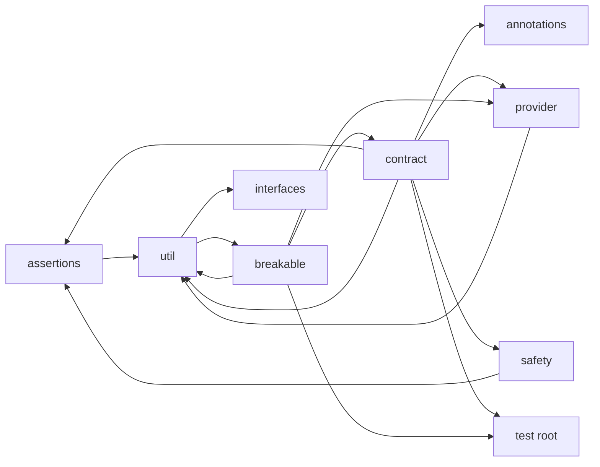

# Architecture

The packages, what each holds, what each depends on, and how the parts fit. Read [constitution.md](constitution.md) first for the goals and the rules.

## 1. Overview

Built. One Maven module, `com.soliscode:soliscode-test`, a jar, with `com.soliscode:soliscode-parent:0.1.2` as its parent (#9, #14). There is no `module-info.java`: the jar is on the class path, with every package open to its users.

Its main code is test code. A user's test class implements a contract interface, supplies a provider of the class under test, and JUnit runs the contract's `default` `@Test` methods as the test class's own. The library starts threads only in `ContentionCoordinator` (section 5).

The library holds almost no global state. The exceptions:
- `AbstractBreakable` keeps one `static final Random`, shared by every breakable, for the faults that pick a random value or index.
- `AssertNoDeadlocks.enableDeadlockDetection()` turns on the JVM's thread-contention monitoring (`ThreadMXBean`), for the whole JVM.

## 2. Dependencies

Built (#9). The POM declares, at compile scope, and at the parent's versions:

| Library | Why |
|---------|-----|
| JUnit Jupiter (`junit-jupiter`, `-api`, `-params`) | The contracts are `@Test`, `@RepeatedTest` and `@ParameterizedTest` methods; `junit-jupiter` brings the engine |
| JUnit Platform commons | `AnnotationSupport` and the other support classes |
| OpenTest4J | `AssertionFailedError`, which the assertions throw, as JUnit's do |
| JSpecify | `@NullMarked` and `@Nullable` |

They are at compile scope because the library is a test library: its main code calls them, and its users' tests run on them. A user declares soliscode-test at test scope. It depends on no other SolisCode library. Versions are in [dependency-management.md](../reference/dependency-management.md).

Its users are soliscode-common and soliscode-quant (soliscode/soliscode-quant#6); each depends on a release of it at test scope, by its own task.

## 3. Packages

Built. Every package is under `com.soliscode.test`, and every main package has a `package-info.java` marked `@NullMarked`.

| Package | What |
|---------|------|
| `test` (the root) | Method support: `InterfaceMethod` (implemented by each interface's method enum), `SupportedMethods`, `MethodSupport` and `MethodStatus`, which say which optional methods a class under test (or a breakable) supports; `AbstractTest` |
| `annotations` | Test tags: `@Slow`, `@VerySlow`, `@ExtremelySlow`, `@ConcurrencyTest` (which also tags the test `@Nondeterministic`), `@Nondeterministic`, and their names in `TestTags`. The build skips `extremely-slow` by default ([build-and-test.md](../reference/build-and-test.md)) |
| `assertions` | `Assertions`, which aggregates the package's assertions: ordering (`AssertGreaterThan` and its kin), types (`AssertImplementsOnly`, `AssertNotInstanceOf`), exceptions (`AssertThrowsAnyOf`, `AssertThrowsDifferent`), arrays, and `AssertNoDeadlocks` |
| `assertions.actions` | Assertions on what an action does to the elements it is given (`AssertConsumeExactly` and its kin), aggregated by `AssertActions` |
| `assertions.collection` | Assertions on collections: contents, by equality and by identity, size and emptiness, aggregated by `CollectionAssertions` |
| `assertions.string` | `AssertStringContains`, `AssertStringContainsInOrder` |
| `breakable` | `Break`, `Breakable`, `AbstractBreakable`, the breakable classes and their builders, and `Breakables`, the factory of builders (section 4) |
| `contract` | `CollectionContractConfig` (whether the class under test permits nulls, duplicates and incompatible types) and its narrowings `DoesNotPermitNulls`, `DoesNotPermitDuplicates`, `DoesNotPermitIncompatibleTypes` |
| `contract.<interface>` | One package per interface, one level under `contract`: `blockingdeque`, `blockingqueue`, `collection`, `concurrentmap`, `deque`, `iterable`, `list`, `map`, `navigablemap`, `navigableset`, `numeric`, `object`, `queue`, `sequencedcollection`, `sequencedmap`, `sequencedset`, `set`, `sortedmap`, `sortedset`, `transferqueue`. Each holds the interface's contract, its method contracts and, where its interface has optional methods, its method enum (`ListMethods`, for example; `contract.sortedset` and `contract.navigableset` have none, since their interfaces' own methods are not optional) |
| `contract.support` | The interfaces a contract extends: `ContractSupport`, `ProviderSupport`, `CollectionContractSupport`, `MapContractSupport`, `OrderedMapContractSupport`, `SortedSetContractSupport`, the provider supports, and the mix-ins that fix a type (`WithInteger`, `WithString`, `WithArrayList`, `WithLinkedList`, `WithSynchronizedCollection`, and others) |
| `interfaces` | `IterableOnly`, `CollectionOnly`, `NumberOnly` and `ObjectOnly`, which hide every method but their interface's, so that code which takes a faster path for a richer interface takes the plain one; `Interfaces` makes them |
| `provider` | `ObjectProvider` and its kinds (`NumberProvider`, `CollectionProvider`, `MapProvider`, `FunctionalProvider`), providers for `Integer`, `Long`, `Short`, `Double`, `Float` and `String`, and the factories `Providers`, `CollectionProviders` and `MapProviders` |
| `safety` | `ContentionCoordinator` (section 5) |
| `util` | Helpers for tests: collection, iterable, reflection and runtime utilities; consumers and suppliers that count or record; `UncachedInteger` and `UncachedString`, values that are equal but not identical; `IdentitySet`; `AlwaysThrows`, `MatchEverything`, `MatchNothing` |

The test sources mirror the main packages, and add `contract.coverage`, which holds `ContractCoverageTest` and `ContractRuns` (section 4).

### 3.1 What depends on what

Built. The imports between main packages today:

- The contracts do not depend on the breakables: a contract tests any implementation of its interface.
- The breakables depend on the contracts, for the method enums (`CollectionMethods`, `ListMethods` and the others) that name the optional methods a breakable may refuse, and for the provider supports (`CollectionProviderSupport`, `MapProviderSupport`) behind each breakable's nested `WithProvider` interface.
- `annotations` and `interfaces` depend on no other package of this project; `provider` only on `util`.

Packages that are odd today:
- The graph has cycles: `util` depends on `breakable` (`IterableTestUtils` calls `Breakables.ensureUnbroken`), and `breakable` depends on `util` and on `contract`, which depends on `util`. No task is filed to break them.
- The method enums live in the contract packages but are used by the breakables, and by `MethodSupport` through `InterfaceMethod` in the root package.
- `contract.concurrentmap` holds only a `package-info.java`; `contract.blockingqueue`, `contract.blockingdeque` and `contract.transferqueue` hold only their method enums. Their interfaces have breakables but no contract.

## 4. Contracts, breakables and providers

Built (#1, #4, #6).

**A contract** is an interface. An interface contract (`ListContract`) extends the contract of each method of its interface (`GetContract`, `SubListContract`, ...) and the interface contracts it inherits from (`SequencedCollectionContract`, and through it `CollectionContract` and `IterableContract`). A method contract extends a support interface (`CollectionContractSupport`, `MapContractSupport`), which gives it the provider of the class under test, the element provider, `supportsMethod(...)` and the configuration in `CollectionContractConfig`. Its test methods are `default` methods annotated `@Test` (or `@RepeatedTest`, or a concurrency test tagged `@ConcurrencyTest`), each with a `@DisplayName`. A test class picks the type under test by implementing a `With...` mix-in or by supplying its own provider.

**A breakable** wraps a JDK implementation and delegates to it, except where a break is set. `AbstractBreakable` holds the breaks (a `Set<Break>`) and the method support it inherits from `MethodSupport`; a breakable checks `hasBreak(...)` in each method a break affects, and `checkMethodSupport(...)` in each optional method. The classes form a hierarchy that follows the interfaces': `BreakableObject` → `BreakableIterable` → `BreakableCollection` → `BreakableSequencedCollection` → `BreakableList`, with the `BreakableSet` and `BreakableQueue` branches below `BreakableCollection`. `BreakableMap` (with `BreakableSortedMap`, `BreakableNavigableMap` and the concurrent maps below it), `BreakableIterator` and `BreakableSpliterator` extend `AbstractBreakable` directly. A break is a `Break` record, a `public static final` constant in the first class that supports it; a subclass inherits its superclasses' breaks. Each breakable but `BreakableIterator`, `BreakableSpliterator` and `BreakableObject` has a nested `Builder`, on `AbstractBreakableBuilder`, which sets its elements, its breaks, the methods it does not support, and whether it is thread safe; `Breakables` makes the builders.

**A provider** makes instances. `ObjectProvider<T>` makes values (a default one, one from an integer seed, unique ones, a copy that is equal but not identical); `CollectionProvider` and `MapProvider` make the class under test, empty or filled from elements.

**`ContractCoverageTest`** shows that each contract can pass and fail (constitution, goal 4). For each covered contract, `ContractRuns` runs every test method, outside JUnit, against a contract instance on a JDK class, then on the unbroken breakable, then on the breakable with each of its breaks in turn, each applied alone through the builder, with the configuration a break needs to show (a method not supported, incompatible types refused). A test method that hangs is stopped after 10 seconds (60 for a concurrency test), and a concurrency test is tried up to 5 times before a break is taken to be missed. Thread-safety breaks are checked by `ThreadSafeCollectionContract` only.

## 5. Threading

Built. The library starts threads only in `ContentionCoordinator`. It runs each configured operation on one subject from a fixed pool of threads of its own (`ContentionCoordinator-N`), holds them at a latch until all are ready, releases them together, calls `Thread.yield()` in the workers' loops to make contention likelier, collects every exception the workers throw, and shuts the pool down with a timeout (5 seconds by default, to start and to finish), so that a deadlocked worker fails the test rather than hanging it. Its configuration is thread safe. The thread-safety contracts (`ThreadSafeAddContract`, `ThreadSafeReadContract` and the others in `contract.collection`) use it, with `AssertNoDeadlocks`, which finds deadlocked threads through `ThreadMXBean`. #12 fixes how often the workers yield.

A breakable is thread safe only when built so (`setSafe(true)` on its builder). Then `AbstractBreakable` holds a `ReentrantLock`, and `BreakableCollection` and `BreakableSequencedCollection` (and the classes below them) run each operation under it, through `runWithBreakableSafety` and `getWithBreakableSafety`, unless the operation's `..._IS_NOT_THREAD_SAFE` break is set, which runs it without the lock. That is how `ThreadSafeCollectionContract` is shown to fail. The lock is `transient`, and restored on deserialization if the object had one. The rest of a breakable's state (its breaks, its method support, a `HashSet` and a `HashMap`) is not synchronized: it is set before the breakable is shared. A builder is not thread safe. The lock guards only the methods `BreakableCollection` and `BreakableSequencedCollection` define; the methods added below them (`BreakableQueue`'s `offer`, for example) and the maps' methods do not take it, whatever `setSafe` says.

## 6. Nullness

Built (#9). Every main package is `@NullMarked` (JSpecify), and `@Nullable`, as a type annotation, marks what may be null (`CollectionTestUtils.listOf(@Nullable E ...)`, for example). Of the test packages, only `contract.coverage` has a `package-info.java`, and only it is `@NullMarked`; NullAway does not check test code. NullAway checks the main code at ERROR. The four places where a contract passes `null` to a JDK method on purpose, to test that it is refused, carry a suppression with its reason (constitution, section 6). Contracts and breakables typed with nullable element types are #13.

## 7. Build

Built (#9, #10, #14). The parent holds the build: every version, Java 25, the enforcer, the licence gate, Checkstyle, Javadoc, ErrorProne and NullAway, the coverage check, and the `${revision}` version. This project adds `.mvn/jvm.config`, the `.errorprone` file that switches ErrorProne on, `jacoco.minimum.coverage` at 0.70, and the test-tag selection (`excludedGroups`, the `all-tests` profile). Every gate passes (#10). [build-and-test.md](../reference/build-and-test.md) says what runs and how; releases are local to `~/.m2` ([RELEASES.md](../../../RELEASES.md)).
