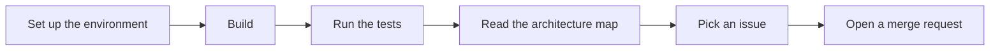

# SolisCode Test developer guide

This guide is for people who want to **build, change or contribute to** SolisCode Test, and for the maintainers who release it. If you only want to *use* SolisCode Test, see the [User guide](../user-guide/README.md).

SolisCode Test builds on the SolisCode parent, `com.soliscode:soliscode-parent` 0.1.17, which gives it its versions, its plugins and its gates. The [parent's user guide](https://gitlab.com/soliscode/soliscode-parent/-/blob/v0.1.17/docs/guide/README.md) describes them; this guide links to it rather than repeating it.

## Path for new contributors

1. [Set up your environment](getting-started/dev-environment.md)
2. [Build from source](getting-started/building.md)
3. [Run the tests](getting-started/running-tests.md)
4. [Read the architecture overview](architecture/overview.md)
5. Follow the [contribution workflow](contributing/workflow.md)

## Contents

### Getting started
- [Development environment](getting-started/dev-environment.md)
- [Building](getting-started/building.md)
- [Running tests](getting-started/running-tests.md)

### Architecture
- [Overview](architecture/overview.md)
- [Code layout](architecture/code-layout.md)

### Contributing
- [Workflow](contributing/workflow.md)
- [Coding standards](contributing/coding-standards.md)
- [Commit conventions](contributing/commit-conventions.md)
- [Testing standards](contributing/testing-standards.md)
- [Documentation standards](contributing/documentation.md)

### Maintainers
- [Release process](maintainers/release-process.md)
- [CI and the Javadoc site](maintainers/ci-cd.md)
- [Issue triage](maintainers/triage.md)
- [Security response](maintainers/security.md)

### Other
- [Troubleshooting the development environment](troubleshooting.md)

## Getting help

Ask in an [issue](https://gitlab.com/soliscode/soliscode-test/-/issues). There is no forum or chat.

## See also

- [User guide](../user-guide/README.md)
- [The design](../design/system/constitution.md), starting with the constitution
