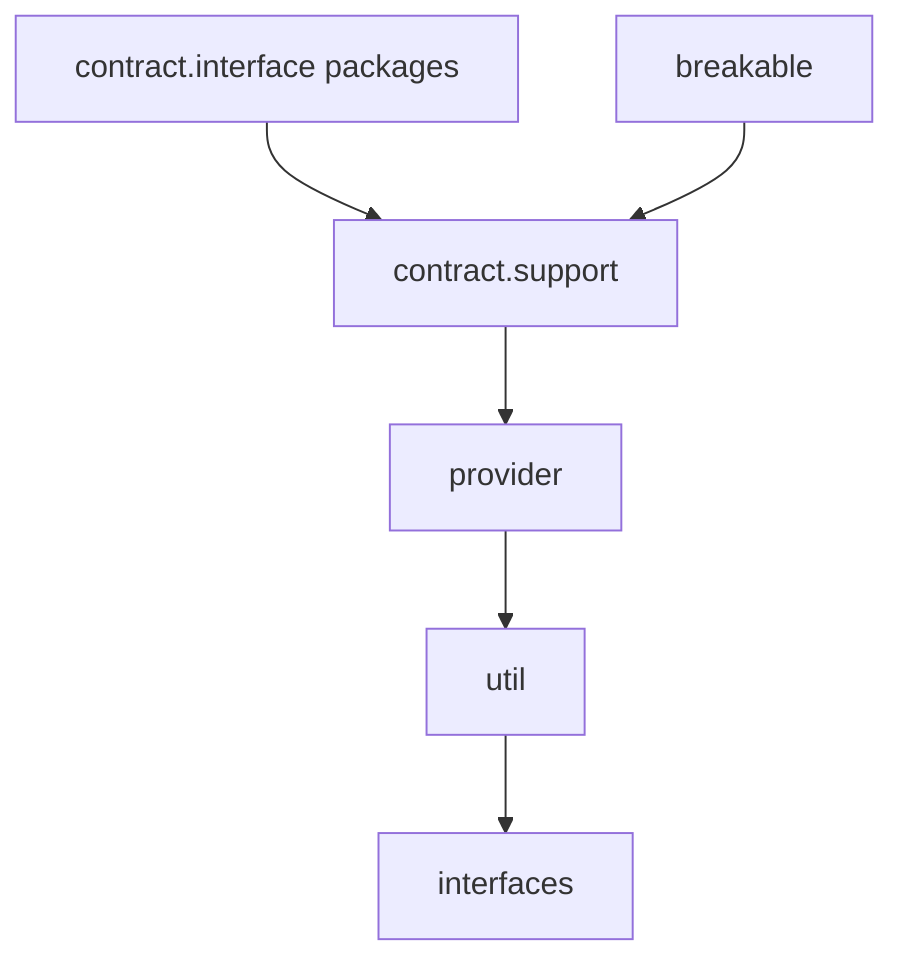

# Code layout

```text
soliscode-test/
├── src/main/java/              # The library: com.soliscode.test and its packages
├── src/test/java/              # Its tests, in the packages of what they test, and two of their own:
│                               #   contract/coverage/ (ContractCoverageTest) and guide/ (the user guide's examples)
├── src/test/resources/         # Test data: a serialized breakable of 0.1.4, which a new release must still read
├── docs/
│   ├── user-guide/             # For people who use the library
│   ├── developer-guide/        # For people who change it
│   └── design/                 # The design, and the decisions in it
├── scripts/                    # verify.sh, release/release.sh, the git hooks, and lib/ (their shared shell code)
├── .mvn/jvm.config             # The JVM options ErrorProne needs
├── .errorprone                 # An empty file that turns ErrorProne on
├── .gitlab/merge_request_templates/  # The merge request template
├── .claude/                    # Claude Code: the plugin's pin, this project's skills and its project file
├── CLAUDE.md, AGENTS.md        # The instructions for Claude Code, and for Codex and other agents
├── pom.xml                     # The build, on the SolisCode parent
├── RELEASES.md                 # The version scheme, and what changed in each release
├── LICENSE.txt, NOTICE         # The licence and the copyright notice
└── CLA.md, CLA-SIGNATURES.md   # The contributor licence agreement, and who has signed it
```

The library is one Maven module, with no `module-info.java`: the jar is on the class path, and every public type in `com.soliscode.test.*` is public API.

## Where to put new code

| If you add… | Put it in | Notes |
|---|---|---|
| A contract for an interface | `src/main/java/com/soliscode/test/contract/<interface>/`, one level under `contract` | `XxxContract`, with a method contract for each method. Its interface's optional methods get an enum in `methods`. Add it to `ContractCoverageTest` ([Testing standards](../contributing/testing-standards.md)) |
| A breakable | `src/main/java/com/soliscode/test/breakable/` | `BreakableXxx`, with its `Break` constants and its builder |
| A provider | `src/main/java/com/soliscode/test/provider/` | `XxxProvider`, and a factory method in the package's factories |
| An assertion | `src/main/java/com/soliscode/test/assertions/` or its packages | `AssertXxx`, aggregated by the package's `Assertions` class |
| A public class elsewhere | the package [architecture.md](../../design/system/architecture.md#3-packages) gives that kind of class | Needs Javadoc; see [Documentation standards](../contributing/documentation.md) |
| A helper of one package | that package, package-private | Such as `ComparatorChecks` in `contract.comparator`. There is no `internal` package |
| A new package | under `com.soliscode.test` | With a `package-info.java` marked `@NullMarked` |
| A test | `src/test/java`, in the same package as the class it tests | Named `*Test` |
| An example for the user guide | `src/test/java/com/soliscode/test/guide/` | Changed with its page ([Documentation standards](../contributing/documentation.md)) |

## Generated files

Don't edit these by hand, and don't commit them:

| Path | Made by | Made again with |
|---|---|---|
| `target/` | Maven | `mvn -B verify` |
| `target/site/en/apidocs/` | The Javadoc tool | `mvn -B site` |
| `.flattened-pom.xml` | The flatten plugin, for the installed POM | `mvn -B install` |

Hand-written code never goes in a package named `generated`, `artiogen` or `jmh_generated`: the coverage and architecture gates leave those packages out as generated, and the Javadoc gate leaves out `jmh_generated`.

## Dependency rules



Dependencies point **down only**. The architecture gate fails a package cycle, between any two packages, each `contract.<interface>` package a slice of its own. The rules of this library's own are in [architecture.md](../../design/system/architecture.md#31-what-depends-on-what), section 3.1, with the whole graph: the contracts do not depend on the breakables, since a contract tests any implementation of its interface; `contract.support` depends on no `contract.<interface>` package and not on `breakable`; and `annotations`, `interfaces` and `performance` depend on no other package of this project. No gate checks those beyond the cycles: the review does.

## See also

- [Architecture overview](overview.md)
- [Coding standards](../contributing/coding-standards.md)
