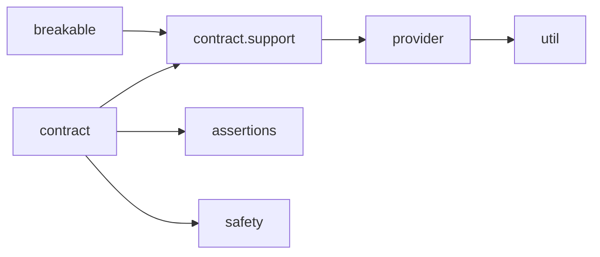

# Architecture overview

SolisCode Test is designed in [`docs/design/`](../../design/). This page says where to look.

## Purpose and scope

SolisCode Test is a Java library for JUnit 6 with three goals: test methods that JUnit lacks (assertions on collections, strings, ordering, exceptions, actions on elements and deadlocks); test suites for the JDK's interfaces, called contracts, that test any class implementing them (every collection interface, then others where a suite is useful, in order of how commonly classes implement them); and thread-safety testing. Each contract follows the JDK's documentation of its interface, and is shown to fail: it is run against a correct JDK class, which must pass, and against a breakable implementation with each of its faults, which must fail. It also holds the performance test library, the test side of the SolisCode parent's performance gate. Its main code is test code: other SolisCode libraries test with it.

## Where the design is

| To learn about | Read |
|---|---|
| What the library is for, its scope, its rules and what it avoids | [constitution.md](../../design/system/constitution.md) |
| The packages, and how they depend on each other | [architecture.md](../../design/system/architecture.md) |
| Public API, naming, nullness, Javadoc and tests | [java-conventions.md](../../design/reference/java-conventions.md) |
| The commands, the gates, the test tags, contract coverage, the releases and the git hooks | [build-and-test.md](../../design/reference/build-and-test.md) |
| Every dependency and its version | [dependency-management.md](../../design/reference/dependency-management.md) |
| How contracts, breakables and providers fit together | [architecture.md](../../design/system/architecture.md#4-contracts-breakables-and-providers), section 4 |
| Threading, and how the concurrency tests are bounded | [architecture.md](../../design/system/architecture.md#5-threading), section 5, and [build-and-test.md](../../design/reference/build-and-test.md#bounds), "Bounds" |
| The performance test library | [architecture.md](../../design/system/architecture.md#8-performance-testing), section 8 |
| Why something is the way it is | The design document for that part. A decision names the task that made it, and the task's issue holds the discussion |

## The main parts

Every package is under `com.soliscode.test`. A user's test class implements a contract, and gives it a provider of the class under test; JUnit runs the contract's `default` test methods as the test class's own.

| Part | What it does | Design |
|---|---|---|
| `contract` and `contract.<interface>` | The contracts: one package for each interface, holding its contract and a method contract for each method, and the choices a test class declares (`CollectionContractConfig`) | [architecture.md](../../design/system/architecture.md#3-packages) |
| `contract.support` | The interfaces a contract extends: providers, the shared checks, and the mix-ins that fix a type (`WithInteger`, `WithArrayList`) | [architecture.md](../../design/system/architecture.md#3-packages) |
| `breakable` | The breakable implementations, their `Break` constants and their builders | [architecture.md](../../design/system/architecture.md#4-contracts-breakables-and-providers) |
| `methods` | The enums that name each interface's optional methods | [architecture.md](../../design/system/architecture.md#3-packages) |
| `provider` | The providers of instances and elements, and their factories | [architecture.md](../../design/system/architecture.md#3-packages) |
| `assertions` and its packages | The assertions JUnit lacks | [architecture.md](../../design/system/architecture.md#3-packages) |
| `safety` | `ContentionCoordinator`, which runs operations from many threads at once, bounded in time | [architecture.md](../../design/system/architecture.md#5-threading) |
| `performance` | The performance test library, which depends on no other package of this project | [architecture.md](../../design/system/architecture.md#8-performance-testing) |
| `annotations`, `interfaces`, `util`, the root package | The test tags, the classes that hide all but one interface, test helpers, and the method-support types | [architecture.md](../../design/system/architecture.md#3-packages) |

## Rules every change keeps

The SolisCode architecture rules are a gate, checked in every build: no package cycles, no use of another package tree's `internal` package, and the rest, listed on the [parent's architecture page](https://gitlab.com/soliscode/soliscode-parent/-/blob/v0.1.19/docs/guide/03-gates/architecture.md#what-it-checks). The library's own rules are in [constitution.md](../../design/system/constitution.md#6-rules-every-change-keeps), section 6: a contract is shown to fail, a break is one fault, contracts respect what the class supports, and the others.

## See also

- [Code layout](code-layout.md)
- [Contribution workflow](../contributing/workflow.md)
