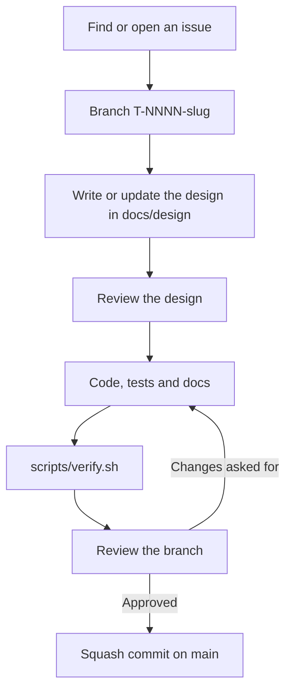

# Contribution workflow

Every change is a **task**: a GitLab issue, worked on a branch of its own, and landed on `main` as one squash commit.



## 1. Start with an issue

Every change starts as an issue in [soliscode/soliscode-test](https://gitlab.com/soliscode/soliscode-test/-/issues). Issue #N is task `T-NNNN`, padded to four digits. Its state is a label:

| Label | Means |
|---|---|
| `workflow::planned` | Filed, not started |
| `workflow::in-progress` | Being worked on |
| `workflow::blocked` | Waiting for another task, named in the issue |

A closed issue is done. The issue holds what the task must do, as a list of acceptance boxes, and the discussion of its decisions. Before you write code for an issue you did not file, say on it that you will, and agree the approach there.

Some decisions are the maintainer's, and are asked on the issue before the work goes on: a new compile-scope dependency, a change to public API that breaks callers, a suppression of a kind [java-conventions.md](../../design/reference/java-conventions.md#suppressions) does not list, a gate rule that does not fit the code, and which JDK interfaces get a contract.

## 2. Branch

```sh
git switch main
git pull
git switch -c T-NNNN-<slug>    # such as T-0042-retry-timeout
```

Branch from `main`, before the first edit. A branch is never reused.

## 3. Design it

A task's design is written under [`docs/design/`](../../design/) before its code: a new section, or a change to the document for the part it touches, or, for a small task, on the issue. Each part of a design document is marked **Built**, **Partly built** or **Designed**, with the task that builds it. A decision is recorded there, named for the task (`the user's decision on #N`). The design is reviewed before any code is written: first by a review agent in Claude Code (`soliscode:design-reviewer`), until it approves, then once by Codex.

## 4. Make your change

A complete change includes:

- [ ] Code that follows the [coding standards](coding-standards.md)
- [ ] Tests, as the [testing standards](testing-standards.md) say: for a bug, a test that fails without the fix, kept; for a new contract or break, its run in `ContractCoverageTest`
- [ ] Javadoc for every public API change ([documentation standards](documentation.md))
- [ ] The user guide updated for a change a user sees, and the developer guide for a change to how the library is built
- [ ] The design documents updated to match, with what is built marked Built
- [ ] An entry under `## Unreleased` in [RELEASES.md](../../../RELEASES.md) for a change a user sees

## 5. Check it

```sh
scripts/verify.sh
```

The full build, from clean, with every gate. It must end green before the branch is reviewed. A gate's finding fails the task like a compile error, and "the tests pass" is no substitute.

## 6. Review

The branch is reviewed against `main`: first by `soliscode:code-reviewer` in Claude Code, until it approves, then once by Codex, and again only after a change in behaviour. Each round's findings and answers go on the issue. Tick each acceptance box as it is done. What a review looks for in this project is the "Review focus" of [`.claude/soliscode-project.md`](../../../.claude/soliscode-project.md).

## 7. Merge

The maintainer merges with the `soliscode:commit-and-merge` skill: one squash commit on `main` ([Commit conventions](commit-conventions.md)), pushed, which closes the issue. Your change ships in the next release ([Release process](../maintainers/release-process.md)).

## From outside the project

The project is private: you need to be a member of it to see it, fork it or open a merge request. Fork the project, work on a branch of your fork as above, and open a [merge request](https://gitlab.com/soliscode/soliscode-test/-/merge_requests). Fill in its template (from `.gitlab/merge_request_templates/`), name the issue, and sign the [CLA](commit-conventions.md#the-cla). Until a lawyer has reviewed the CLA, no contribution from anyone but the copyright holder is merged, as [CLA.md](../../../CLA.md) says. The maintainer fetches it as a task branch, reviews it and merges it as above, then closes the merge request with a note naming the squash commit.

## See also

- [Commit conventions](commit-conventions.md)
- [Issue triage](../maintainers/triage.md)
