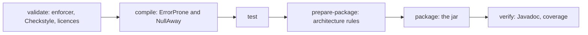

# Building

Run every command from the repository's root. Run one Maven build at a time: builds share `target/` and `~/.m2`.

## Quick build

```sh
mvn -B verify
```

That is the whole build, with every gate and every test of the default selection, in about five minutes. The jar is in `target/`. The [parent's guide](https://gitlab.com/soliscode/soliscode-parent/-/blob/v0.1.17/docs/guide/04-everyday-work.md#the-whole-build) shows what its output means.

For a quicker check while you work, the install gate runs every gate but the tests and the coverage check:

```sh
mvn -B -Djacoco.check.skip=true -DskipTests install
```

It runs the enforcer, the licence check and Checkstyle, compiles the main code with ErrorProne and NullAway, and the test code, and builds the Javadoc. It does not run the architecture gate, which runs with the tests. ErrorProne's findings print with an `errorprone.info` link: `grep -c 'errorprone.info' <log>` counts them, and the count must be 0.

## Commands

| Command | What it does |
|---|---|
| `scripts/verify.sh` | The full build from clean, recorded. A release needs a green record for the tree it releases. Run it before you say a change is done |
| `mvn -B verify` | The same build, not recorded |
| `mvn -B -Djacoco.check.skip=true -DskipTests install` | The install gate: every gate but the tests, the architecture rules and the coverage check |
| `mvn -B clean` | Removes `target/` |
| `mvn -B validate` | The gates that run before compiling: the enforcer, Checkstyle and the licence check |
| `mvn -B site` | The site, with the Javadoc in `target/site/en/apidocs/` and the reports |
| `mvn -B install` | Installs `0.1-SNAPSHOT` into `~/.m2`, for another library to try before a release |
| `mvn -B dependency:analyze` | Libraries used but not declared, or declared but not used |

The [parent's guide](https://gitlab.com/soliscode/soliscode-parent/-/blob/v0.1.17/docs/guide/04-everyday-work.md#the-commands) lists the commands every SolisCode library shares, with their output. This project's own list, with each command's detail, is [build-and-test.md](../../design/reference/build-and-test.md#commands), "Commands".

## What the build needs

The SolisCode parent at 0.1.17, and `com.soliscode:soliscode-performance-api` 0.1.17, which the parent's install installs with it, in `~/.m2` ([Development environment](dev-environment.md#local-setup)). The POM's version is `${revision}`, `0.1-SNAPSHOT` unless a release sets it with `-Drevision`.

The parent sets every plugin and the version of each library it manages. Don't add a version of your own for either: the build refuses a change to a gate's plugin, and a managed library is named without a `<version>`. This project adds no plugin and no plugin configuration of its own; what it does add to the parent's build is in [build-and-test.md](../../design/reference/build-and-test.md#what-this-project-adds), "What this project adds".

## Build pipeline



## See also

- [Running tests](running-tests.md)
- [The gates](https://gitlab.com/soliscode/soliscode-parent/-/blob/v0.1.17/docs/guide/03-gates/README.md), in the parent's guide
