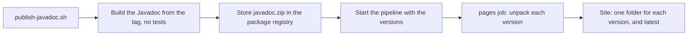

# CI and the Javadoc site

SolisCode Test has **one** pipeline, and it builds nothing. The gates and the tests run on the developer's machine, with `scripts/verify.sh`, whose green record a release needs. No merge request or push starts a pipeline. The old `.gitlab-ci.yml`, which included a file the SolisCode parent does not have, failed before any job ran, and was removed (#11); the one there now is the parent's Pages pipeline (#77).

## What takes CI's place

| Check | Where it runs | What it guards |
|---|---|---|
| The pre-commit hook | Your machine, on each commit that changes `src/`, `pom.xml`, `.mvn/` or `.errorprone` | The gates before the tests: the enforcer, the licence check, Checkstyle, ErrorProne and NullAway |
| The pre-push hook | Your machine, on a push to `main` | Refuses a commit whose tree the pre-commit hook did not build (one made with `--no-verify`) |
| `scripts/verify.sh` | Your machine, before a branch is reviewed and before a release | Every gate and every test, from clean, recorded for the tree |
| `release.sh` | The maintainer's machine | Refuses to release a tree without a green record |

[build-and-test.md](../../design/reference/build-and-test.md#git-hooks), "Git hooks" and "The record of a green build", has the detail.

## The pipeline

| Pipeline | Started by | Definition | What it does |
|---|---|---|---|
| Pages | `scripts/publish-javadoc.sh`, through GitLab's API | `.gitlab-ci.yml` | Puts every stored version of the Javadoc into the Pages site |

- The script builds the release's site on your Mac, from its tag, with `mvn -B -Drevision=0.1.N -DskipTests -Dmaven.test.skip.exec=true package site`. It runs no test: not the unit tests, not a suite a module's POM turns on itself, and not the tests the site's Surefire report would run again. The release ran them all, and a flaky test must not fail a publish.
- The pipeline runs on the project's default branch, the one GitLab names in the project's settings (here `main`), and reads `.gitlab-ci.yml` from there. `scripts/publish-javadoc.sh --check` prints it.
- `workflow:rules` runs a pipeline only when it is started through the API. A push, a merge request or a schedule starts none.
- The pipeline's one input, `versions`, lists every stored version, separated by spaces.
- The `pages` job, on a pinned `alpine` image, downloads each version's `javadoc.zip` with the job's token, and unzips it into `public/<version>/`. It writes `public/index.html`, which lists the versions, and copies the newest to `public/latest/`.
- The job is in the resource group `pages`, so two deployments never run at once. The script refuses to start one while another pipeline is running.
- A deployment replaces the whole site, so each one holds every version.
- The script builds the release in a worktree of its tag, so the working copy is not touched. Run no other build, and make no commit, until it ends: the git hooks start Maven.
- Publish from one place at a time. Two publishers at once could deploy an older list of versions after a newer one. The script's last check finds that and fails; run it again, and it redeploys every stored version.

## The site

| Address | What |
|---|---|
| `https://soliscode.gitlab.io/soliscode-test/` | The list of versions |
| `https://soliscode.gitlab.io/soliscode-test/<version>/` | One release's Javadoc, from 0.1.6 on |
| `https://soliscode.gitlab.io/soliscode-test/latest/` | A full copy of the newest release's Javadoc. Links into the Javadoc from the docs go through it, so they don't go stale |

What the site leaves out, such as generated packages and test-support or benchmark modules, is set in the root `pom.xml` with the parent's `soliscode.javadoc.site.excludePackageNames` and `soliscode.javadoc.site.skippedModules` (from soliscode-parent 0.1.17). This project sets neither: it has one module and no generated packages. The Javadoc gate still checks every package.

Each release's Javadoc is stored once, as the generic package `javadoc`, version `<version>`, file `javadoc.zip`. To replace a stored version, delete that package version in GitLab first, then run the script again.

## Set up once

A maintainer does these once, in the project's settings in GitLab, or with `glab api`. Each was done for #77, with the owner's approval:

- **CI/CD on.** Every SolisCode project has it on.
- **A project runner on each publisher's Mac.** The job is tagged `soliscode-pages`, so GitLab's own runners, whose free compute minutes run out, never take it. With Docker running, once per machine: `brew install gitlab-runner`, then `scripts/publish-javadoc.sh --register-runner`, which creates the runner in GitLab (the Maintainer role) and registers it in `~/.gitlab-runner/config.toml` without printing its token. The script starts it for each publish's one job, and it exits; nothing runs in the background. A runner paused in the project's Settings > CI/CD > Runners takes no job, so `--check` calls it not ready and a publish refuses until it is resumed.
- **Pages access: everyone.** The script refuses a Pages site or a package registry that reaches wider than the repository: a library's Javadoc is never readable more widely than its source. So that everyone can read the Javadoc, SolisCode Test is a public project, with Pages `enabled`, which on a public project means everyone (the owner's decision on #77).
- **Unique domain off**, so that the site's address is `https://soliscode.gitlab.io/<project>/`, here `https://soliscode.gitlab.io/soliscode-test`: `glab api --method PATCH projects/<id>/pages -f pages_unique_domain_enabled=false`. With it on, the address is one GitLab makes up, which the script prints. This is a settings change the project's owner approves.
- **No change** to who may set pipeline variables. The pipeline takes its versions as an input, which that setting does not cover.

`scripts/publish-javadoc.sh --check <version>` prints the project's settings, whether the runner is ready, and who can read the site, and changes nothing.

## Secrets

The pipeline needs none: its job reads the package registry with its own job token. `publish-javadoc.sh` uses your own `glab` login. No secret is stored in the project. The runner's token is in `~/.gitlab-runner/config.toml` on your Mac, readable by you alone; never print it or commit it.

## Changing the pipeline

`.gitlab-ci.yml` and `scripts/publish-javadoc.sh` come from the SolisCode templates, unchanged, at the revision in `docs/.doc-templates-version`. Check a change with `glab ci lint` before you commit it: a broken file fails every pipeline the script starts. The `alpine` image's tag is pinned in both files, and changed in the parent with the parent's versions.

## Dependency updates

No bot opens update requests. Versions of plugins and managed libraries come from the SolisCode parent, and change when `<parent>` moves to a new release ([Moving to a new release](https://gitlab.com/soliscode/soliscode-parent/-/blob/v0.1.17/docs/guide/05-new-release.md); in this project the parent's release is in five places, which [`CLAUDE.md`](../../../CLAUDE.md), "Moving the pin", lists). The vulnerability check runs on request: `mvn -B -P dependency-check -DskipTests verify`, with an NVD API key in `NVD_API_KEY` ([the parent's dependency check](https://gitlab.com/soliscode/soliscode-parent/-/blob/v0.1.17/docs/guide/03-gates/dependency-check.md)). It has not been run here yet.

## See also

- [Release process](release-process.md)
- [Running tests](../getting-started/running-tests.md)
- [build-and-test.md](../../design/reference/build-and-test.md#the-published-javadoc), "The published Javadoc"
