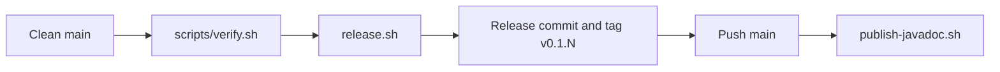

# Release process

## Versioning

Before 1.0.0, a release is `0.1.N`: one past the highest `v0.1.*` tag. `main` is always `0.1-SNAPSHOT`. The POM's version is `${revision}`, and a release sets it with `-Drevision`. [RELEASES.md](../../../RELEASES.md) holds the version scheme and says what each release changed. A change to public API that breaks callers is the maintainer's decision, and is recorded there.

The old `org.soliscode:soliscode-test` releases, `1.0.0` to `1.0.14`, are not part of this scheme: their tags (`v1.0.*`) stay, and are not counted.

No Maven artifact is deployed to a remote repository before 1.0.0 (the Javadoc's zip goes to the project's package registry, as "Publish the Javadoc" says). A release is installed into the local Maven repository of the machine that made it, and tagged, and others build it from its release commit ([Installation](../../user-guide/getting-started/installation.md)).

## When to release

A release is made only when the maintainer asks for one, with `/release` in Claude Code (the project's `release` skill, `.claude/skills/release/SKILL.md`), or when a task's acceptance list asks for one. Never just because a task merged. A release covers every task merged since the previous tag; with none, there is nothing to release.

## Release flow



## Checklist

### Prepare

- [ ] You are on `main`, with a clean working copy (`git status --porcelain` prints nothing), and no other build running. Save files an editor changed (`.settings/`, `.classpath`, `.project`, `.factorypath`) as a patch, restore them, and reapply the patch after the release.
- [ ] The git hooks are installed (`git config core.hooksPath` prints `scripts/git-hooks`): the release commit runs the pre-commit hook.
- [ ] `scripts/verify.sh` is green for this tree. `release.sh` refuses a tree without a green record. Check for one with `ls "$(git rev-parse --git-common-dir)/soliscode/verified/$(git rev-parse 'HEAD^{tree}')"`. A task branch's record counts when the squash merge's tree is the branch's; otherwise run `scripts/verify.sh` once on `main`.
- [ ] The release's changes are written as Markdown bullets, without a heading, in a file **outside** the repository. Start from the bullets under `## Unreleased` in `RELEASES.md`, grouped by task, and write "None." if nothing changes for a user.
- [ ] [Upgrading](../../user-guide/upgrading.md) says what a user must do for each breaking change.

### Release

- [ ] Run:

  ```sh
  scripts/release/release.sh --changes <file> --trailer "Co-Authored-By: …"
  ```

  `--trailer` is optional, and may be given more than once. The script picks the version, builds and installs it from clean, writes its entry in `RELEASES.md` (moving the `## Unreleased` bullets into it), commits `Release 0.1.N`, and makes the annotated tag `v0.1.N`. The tag is not signed: no SolisCode release is signed before 1.0.0. It pushes nothing. [build-and-test.md](../../design/reference/build-and-test.md#releasesh), "`release.sh`", says what it does at each step, and what it does when a step fails.
- [ ] Push `main`: `git push origin main`. The tag stays local unless the maintainer asks for it to be pushed: `git push origin v0.1.N`. If the push is refused, `origin` has moved on and the release was made on a stale `main`: stop, and don't publish until `main` is reconciled and pushed.

### Publish the Javadoc

- [ ] Run, in the background:

  ```sh
  scripts/publish-javadoc.sh 0.1.N
  ```

  It builds the release's Javadoc in a worktree of its local tag (`mvn -B -Drevision=0.1.N -DskipTests -Dmaven.test.skip.exec=true package site`), running none of the tests, which the release ran already, stores it in the project's package registry, and starts the Pages pipeline, whose one job runs on this Mac and puts the newest stored versions into the site (three, or the root POM's `soliscode.javadoc.site.versions`), refusing a site too large for GitLab Pages. Then it checks the site. Run no other build, and make no commit, until it ends: the git hooks start Maven. It needs `glab`, logged in, `zip`, `curl` and `python3` 3.11 or later, and the runner its job runs on: `gitlab-runner` and Docker, with the runner registered once on this Mac ([CI and the Javadoc site](ci-cd.md)). The pipeline runs on the project's default branch as GitLab has it, `main`, and reads `.gitlab-ci.yml` from there, so push `main` first.
- [ ] Open `https://soliscode.gitlab.io/soliscode-test/0.1.N/` and `https://soliscode.gitlab.io/soliscode-test/latest/`. The script prints the site's address.

A failed publish does not undo the release: the tag and the installed artifacts stand. Run the script again; it skips a version already stored. `scripts/publish-javadoc.sh --check 0.1.N` prints what the project's settings let it publish, and changes nothing. [CI and the Javadoc site](ci-cd.md) has the detail.

### After the release

- [ ] Check that `## Unreleased` in `RELEASES.md` is empty again, and the new entry is right.
- [ ] Tell the libraries that test with SolisCode Test, soliscode-common and soliscode-quant, that the release is out.

## No release branches, and no rollback

There are no release branches and no back-ported fixes. A fault in a release is fixed on `main`, and ships in the next release. A release is never withdrawn: its tag stays. There is no signing, SBOM or provenance step before 1.0.0.

## See also

- [CI and the Javadoc site](ci-cd.md)
- [RELEASES.md](../../../RELEASES.md)
- [Moving to a new release](https://gitlab.com/soliscode/soliscode-parent/-/blob/v0.1.19/docs/guide/05-new-release.md), in the parent's guide, for moving `<parent>`
