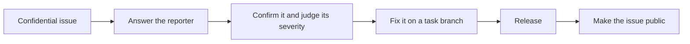

# Security response

## Reporting a security problem

Don't describe a security problem in a public issue. Open a [new issue](https://gitlab.com/soliscode/soliscode-test/-/issues/new) and tick **This issue is confidential** before you create it. Only the reporter and the project's members can see a confidential issue.

Say which version you use, what the problem is, and how to reproduce it. If you made the issue public by mistake, a maintainer makes it confidential.

The rest of this page is for maintainers.

## Process

1. **Answer** the reporter in the issue. Don't discuss the details anywhere public.
2. **Confirm** the problem, and judge its severity, for example with CVSS.
3. **Fix** it as any task, on a branch `T-NNNN-<slug>`. Keep the details out of the commit message and `RELEASES.md` until the release is out.
4. **Release** the fix in the next release ([Release process](release-process.md)). Only the newest release gets fixes before 1.0.0.
5. **Disclose:** once the release is out, make the issue public if the reporter agrees, and credit them if they wish.

A vulnerability in a dependency is found with the parent's [dependency check](https://gitlab.com/soliscode/soliscode-parent/-/blob/v0.1.14/docs/guide/03-gates/dependency-check.md). A fix to a managed dependency's version is made in the SolisCode parent, and reaches SolisCode Test when `<parent>` moves.

## Who responds

The maintainer, Evan Bergstrom (`evanbergstrom1` on GitLab), watches the project's confidential issues. The project sets no response times.

## See also

- [Issue triage](triage.md)
- [Upgrading](../../user-guide/upgrading.md#version-support)
