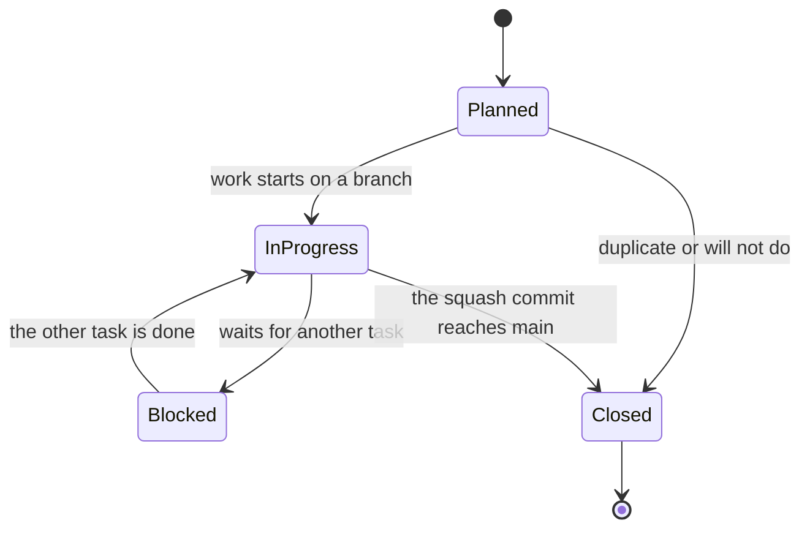

# Issue triage

## Issue lifecycle

## Labels

Each open issue has one `workflow::` label, which says its state:

| Label | Meaning |
|---|---|
| `workflow::planned` | Filed, and not started |
| `workflow::in-progress` | Being worked on, on its branch |
| `workflow::blocked` | Waiting for another task, which the issue names (`**Blocked by:** #M`) |

A closed issue is done. The project's other labels are listed in its project file, `.claude/soliscode-project.md`, under "Labels":

| Label | Meaning |
|---|---|
| `area::build` | The build and its gates |
| `area::ai-dev` | The agent instructions, skills and reviewers |
| `bug` | A fault in the library |
| `fix` | A bug (a group label this project may use) |
| `quality` | Quality work that is not a fault in the library, such as missing tests (a group label this project may use) |

The project has no modules or features of its own, so it uses no `module::` or feature labels. The group's other labels belong to other projects. Don't put one on an issue here unless the project file lists it, and never rename or delete a group label: that changes it for every project in the group.

## Triage steps

1. Reproduce the problem, or check that it is a clear request.
2. Look for a duplicate. Close the new issue with a link to the old one if there is one.
3. Add `workflow::planned` and the labels that fit from the project file. Title it `T-NNNN: <title>`, the issue number padded to four digits, with its acceptance boxes in the description.
4. A question: answer it in the issue, and close it when it is answered.
5. A security problem filed in public: make the issue confidential at once, and follow [Security response](security.md).

## See also

- [Contribution workflow](../contributing/workflow.md)
- [Security response](security.md)
