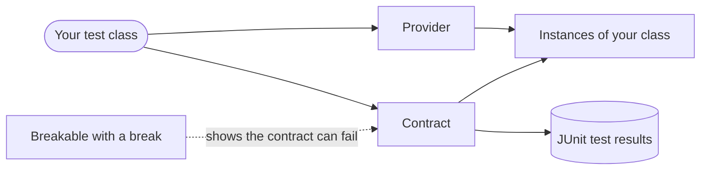

# Concepts

These pages explain how SolisCode Test works and why it is designed the way it is. Read them to build a mental model. You don't need them to follow the tutorial.

## Overview

Your test class implements a **contract**: an interface whose default `@Test` methods test any class that implements one JDK interface, as the JDK documents it. JUnit runs those methods as your class's own. The contract gets the objects it tests from a **provider** your test class returns: a factory of instances of your class, and of their elements. Each contract is itself tested against a **breakable**, an implementation of the same interface that is correct until a **break** is switched on, so that the library knows each contract can fail. The thread-safety contracts, and your own thread-safety tests, run under a **time bound**, so that a deadlock or a hang fails the test instead of the build.

## Topics

- [Contracts](contracts.md): the test suites, one for each JDK interface, and how a test class runs one
- [Providers](providers.md): how a contract gets the instances and elements it tests
- [Breakables and their breaks](breakables.md): implementations with faults you switch on, which show that a test can fail
- [Bounded thread-safety tests](bounded-thread-safety-tests.md): how the concurrency tests are bounded in time, and why there is no `Thread.sleep`

## See also

- [How-to guides](../how-to/README.md)
- [Glossary](../glossary.md)
