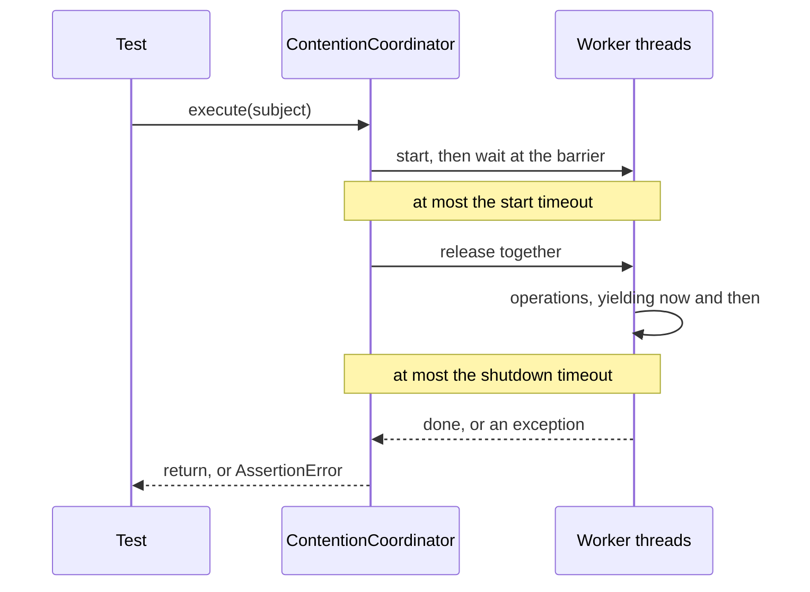

# Bounded thread-safety tests

**In brief:** every thread-safety test in the library, and every one you write with `ContentionCoordinator`, has a limit on how long it can take, so that a deadlock or a hang fails the test with a message rather than stopping the build. None of them waits with `Thread.sleep`.

## What it is

A thread-safety test runs operations on one object from many threads at once and checks what must hold whatever the interleaving. Two things make such a test hard to trust: a fault may not show on every run, and a fault may make the test never finish. A deadlocked `put` does not fail; it waits.

The library bounds each test in layers:

- **`ContentionCoordinator`** waits at most 5 seconds (by default) for its threads to be ready, and at most 5 seconds for them to finish. Past either, it fails with a `Timeout: …` message and shuts its threads down; when they do not finish, it first checks for deadlocked threads, and reports them if there are any.
- **`@ConcurrencyTest`** runs the test method 5 times, since one run may miss a race, and gives each run a JUnit timeout of 10 seconds.
- **Calls that may block** (a `BlockingQueue`'s `take`, a `Future`'s `get`) are made by the contracts on a thread of their own, with a time limit, after which the call is interrupted and the test fails.
- **Work with a budget**: the transfer queue's hand-offs stop after a time budget, so that they finish on a loaded machine.

## Why it works this way

**No `Thread.sleep`.** A test that sleeps to "let the other thread get there" is slow when the machine is fast and wrong when it is slow. The library's tests wait for an event instead: a barrier the threads reach, a latch, a call that returns, each with a timeout that is only reached when something is wrong. A passing test takes as long as its work, not as long as its sleeps.

**Contention is made, not hoped for.** Released together from a barrier, and yielding now and then, the threads interleave more than threads started one by one. On a busy machine a thread can still make all its calls before another runs; a phase interval holds them together every few calls.

**Repeats, not certainty.** A race is a matter of chance, so a single passing run proves little. The contracts' tests run 5 times, and each is shown, in the library's own tests, to fail against its thread-unsafe [break](breakables.md). The trade-off is time: the thread-safety contracts take seconds each, not milliseconds.

## How it relates to other concepts

- **[Contracts](contracts.md):** the thread-safety contracts are built on `ContentionCoordinator`, and run under these bounds.
- **[Breakables](breakables.md):** the `…_IS_NOT_THREAD_SAFE` breaks are how each thread-safety test is shown to catch a race.

## Common misconceptions

- **"A passing thread-safety test proves the class is thread-safe."** It shows the class survived the interleavings that happened. That is why each test is repeated, and each is shown to fail against a known race.
- **"A timeout means the class is slow."** It can, but first look for a deadlock, or an operation that waits for another thread that never comes. `ContentionCoordinator` reports deadlocked threads when it times out.

## See also

- How-to: [How to write a thread-safety test](../how-to/write-a-thread-safety-test.md)
- Reference: [Error reference](../reference/errors.md#contentioncoordinator-timeouts)
