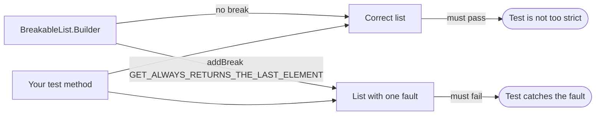

# Breakables and their breaks

**In brief:** a breakable is an implementation of a JDK interface that keeps the interface's contract until you switch on a break: a named fault, such as `get` returning the wrong element. A test that passes against the unbroken breakable and fails against the broken one is a test that can catch that fault.

## What it is

A test that never fails tells you nothing. A contract test can pass because the class is correct, or because the test checks nothing: it asserts on a value it set itself, or compares the class with itself. The way to tell them apart is to run the test against a class with a known fault and see it fail.

The breakables are those classes, for the interfaces the library has contracts for: `BreakableList`, `BreakableMap`, `BreakableIterator`, `BreakableComparator`, `BreakableFuture`, `BreakableExecutorService` and the others in `com.soliscode.test.breakable`. Each holds the faults it can make as `Break` constants on its class, each with a description of the one thing it changes:

- `BreakableList.GET_ALWAYS_RETURNS_THE_LAST_ELEMENT`
- `BreakableList.SET_ALWAYS_RETURNS_NULL`
- `BreakableCollection.ADD_IS_NOT_THREAD_SAFE`
- `BreakableComparator.COMPARE_IS_CYCLIC`

A breakable collection or map is made by its `Builder`, with `addBreak` for each fault you want, `doesNotSupport` for an optional method it should refuse, and `setSafe(true)` to make it thread-safe. The others (`BreakableIterator`, `BreakableComparator`, `BreakableFuture` and the rest) take their breaks in their constructor, most of them over a delegate that does the real work. With no break, it is a correct implementation of its interface; each break changes only what its description says.

## Why it works this way

**One fault at a time, by name.** A break is a constant, not a mock you program, so the fault is the same in every test that uses it, and its name says what it is. When a test fails to catch a break, the break's name says what the test misses.

**Correct by default.** The unbroken breakable must pass every contract. That checks the other side: a test that fails against a correct implementation is too strict, or reads the interface wrongly.

**This is how the library tests itself.** Every contract is run against a JDK class, against the unbroken breakable, and against the breakable with each of its breaks, and must fail for each (`ContractCoverageTest`). A break a contract cannot catch carries the reason why. You can do the same for test methods of your own.

**Thread-safety breaks.** A breakable built with `setSafe(true)` runs each method under a lock; a break named `…_IS_NOT_THREAD_SAFE` runs that one method without it. A thread-safety test that does not fail against that break does not make the threads contend on that method.

## How it relates to other concepts

- **[Contracts](contracts.md):** the breakables are what shows that each contract can fail.
- **[Providers](providers.md):** `BreakableBuilder.collectionProvider` makes a provider from a breakable's builder, so a contract runs against a breakable exactly as it runs against your class.
- **[Bounded thread-safety tests](bounded-thread-safety-tests.md):** the thread-unsafe breaks are how a thread-safety test is shown to catch a race.

## Common misconceptions

- **"A breakable is a mock."** It is a working implementation, correct until a break is set, and it keeps the interface's contract for everything a break does not touch: `equals`, `hashCode`, iteration and views included.
- **"A break makes a method throw."** Some do (`…_THROWS_WRONG_EXCEPTION…`, with `WrongException`), but most return a wrong result, skip a change, or change the wrong element, as real faults do.

## See also

- How-to: [How to check that a contract can fail, with a breakable](../how-to/check-a-contract-can-fail.md)
- Reference: [API reference, breakables](../reference/api.md#breakables)
