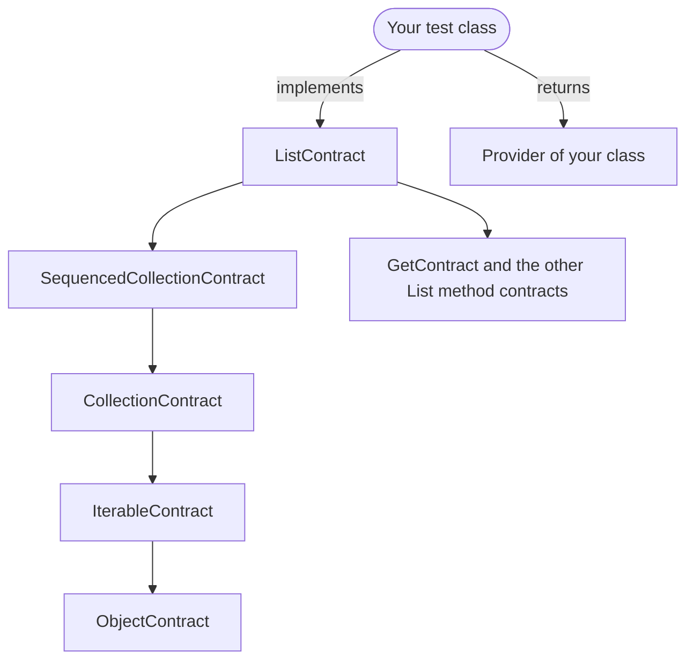

# Contracts

**In brief:** a contract is a Java interface of default `@Test` methods that tests any class implementing one JDK interface, against what the JDK's documentation of that interface says. Your test class implements the contract, and JUnit runs its methods as your class's own.

## What it is

The JDK's interfaces say much more than their method signatures. `List.set` returns the element it replaced; `Set` holds no two equal elements; `Map.equals` compares entries, whatever the map's class; `Comparator.compare` is transitive. A class that compiles against the interface can break any of these, and its own tests seldom check them all.

A contract checks them. `ListContract<L, E>` holds the tests of every `List` method, and, because `List` extends `SequencedCollection` and `Collection`, it extends their contracts too. Each method has a method contract of its own (`SetContract` in `contract.list` for `set`, `SubListContract` for `subList`), and the interface's contract combines them. Your test class implements `ListContract<YourList<Integer>, Integer>`, supplies a [provider](providers.md), and has every one of those tests.

A contract cannot assume more than the interface promises, so where the interface lets an implementation choose, your test class says what it chose: that it refuses `null` (`DoesNotPermitNulls`), holds no duplicates (`DoesNotPermitDuplicates`), refuses an argument of another type (`DoesNotPermitIncompatibleTypes`), or does not support an optional method (`doesNotSupportMethod`, kept by `AbstractTest`). The contract then expects the exception the interface documents for that choice, rather than skipping the test. The [configuration reference](../reference/configuration.md) lists each choice.

The thread-safety contracts (`ThreadSafeCollectionContract`, `ThreadSafeConcurrentMapContract` and the others) extend an interface's contract with tests of its methods called from many threads at once.

## Why it works this way

**Interfaces of default methods, not base classes.** A test class can implement several contracts (`ListContract` and a contract of your own), and still extend the class it needs. JUnit runs inherited default `@Test` methods, so nothing has to be registered.

**The JDK's documentation, not one implementation.** A contract is written from the Javadoc of the interface, not from what `ArrayList` happens to do. Where it reads the documentation more strictly or more loosely, its Javadoc says so. The library runs each contract against a JDK class, which must pass.

**A contract that cannot fail is worth nothing.** Each contract is also run against a [breakable](breakables.md) with each of its breaks, and must fail for each one, unless the break carries a reason the contract cannot see it. So when a contract passes against your class, it passed tests that are known to catch faults.

The trade-off is size: a contract runs many tests (139 for `List`), each on fresh instances, and a thread-safety contract takes seconds. They are for the classes whose correctness matters enough to test against the whole interface.

## How it relates to other concepts

- **[Providers](providers.md):** a contract makes nothing itself; every instance and element it tests comes from the provider your test class returns.
- **[Breakables](breakables.md):** they test the contracts, so that a passing contract means something.
- **[Bounded thread-safety tests](bounded-thread-safety-tests.md):** the thread-safety contracts are built on `ContentionCoordinator`, with its time bounds.

## Common misconceptions

- **"A contract tests the JDK's classes."** It tests your class. The library runs each contract against a JDK class only to show that it passes against a correct implementation.
- **"A refused optional method is a failure."** It is not, once you say so: `List.add` may throw `UnsupportedOperationException`, and `doesNotSupportMethod(CollectionMethods.ADD)` makes the contract expect exactly that.

## See also

- How-to: [How to test a collection or map with its contract](../how-to/test-a-collection.md)
- Reference: [API reference, contracts](../reference/api.md#contracts)
