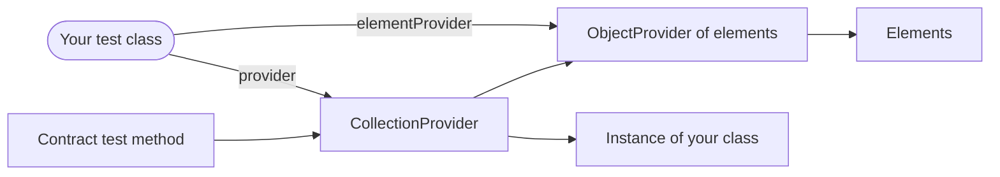

# Providers

**In brief:** a provider is the factory a contract gets everything it tests from: instances of your class, empty, copied or filled, and the elements, keys and values to put in them.

## What it is

A contract test needs objects in known states: an empty list, a list of five unique elements, a copy of a list, an element the list does not hold. It cannot make them itself, since it does not know your class's constructors or what your elements are. So each contract asks your test class for a provider, through `provider()`, and makes every object through it.

There are two levels:
- An **object provider** (`ObjectProvider<T>`) makes values of one type: a default instance, an instance from a seed (different seeds, unequal instances), and an equal copy. From those three it gives the rest: unique instances, equal instances, and an instance not in a collection. `Providers` has them for `Integer`, `Long`, `Short`, `Double`, `Float` and `String`; you write one for a type of your own.
- A **collection provider** (`CollectionProvider<C, E>`) or **map provider** (`MapProvider<K, V, M>`) makes instances of your class, filled with elements from an object provider: empty, as a copy, from a collection, as a singleton, with unique elements. `CollectionProviders.from` and `MapProviders.from` make one from your class's constructors.

The interfaces beyond the collections have providers of their own, shaped by what their contract needs: `ComparatorProvider` gives a comparator and samples in order, `FutureProvider` gives futures it can finish, `ExecutorServiceProvider` gives executors, `IteratorProvider` gives iterators over a source it can change.

## Why it works this way

**Seeds, not random values.** An object provider makes an instance from a `long` seed, so a test asks for "five unique elements" and gets the same five on every run: a failure reproduces. Where a test wants variety it asks for a random supplier, which records what it made.

**Copies that are equal.** A contract compares what your class returns with what it put in by `equals`, as the interfaces do, and `copyInstance` gives it an equal instance to compare with: for a mutable type, write it to return a separate object, so that a test can change one and not the other. An immutable type's copy may be the instance itself, as `StringProvider`'s is.

**Wrapping.** `CollectionProviders.wrap` and `MapProviders.wrap` put each instance through a function, so a wrapper of the JDK's (`Collections.unmodifiableList`, `Collections.synchronizedCollection`) or of your own is tested with the same contract as the class it wraps.

## How it relates to other concepts

- **[Contracts](contracts.md):** a contract makes nothing but through the provider; what it tests is what the provider makes.
- **[Breakables](breakables.md):** `BreakableBuilder.collectionProvider` turns a breakable's builder into a provider, so that a contract can be run against a breakable as against your class.

## Common misconceptions

- **"The element provider is only for the contents."** The contracts also use it for the elements they look for and do not find, and for the elements they add. A provider whose seeds give equal instances makes those tests fail, or stop with `no instance found that the collection does not contain`.

## See also

- How-to: [How to supply instances and elements with a provider](../how-to/supply-instances-and-elements.md)
- Reference: [API reference, packages](../reference/api.md#packages)
